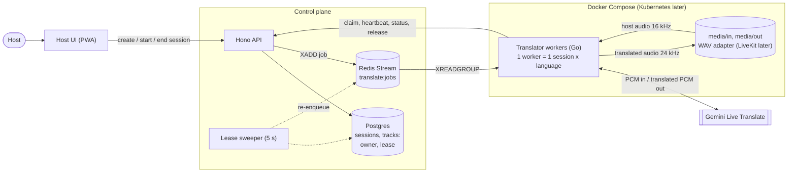
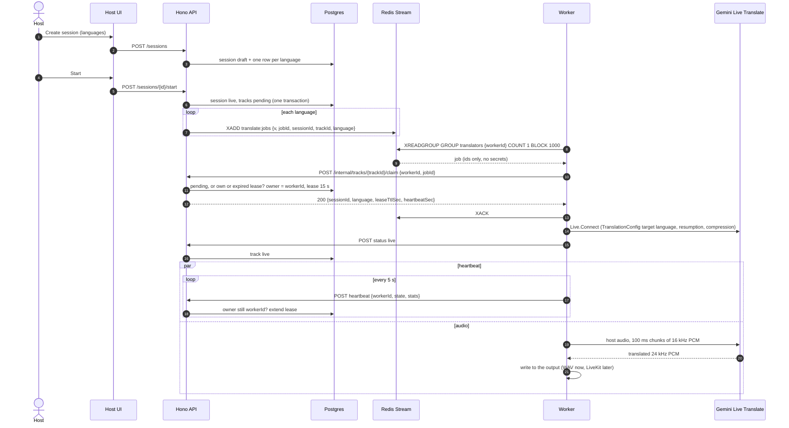
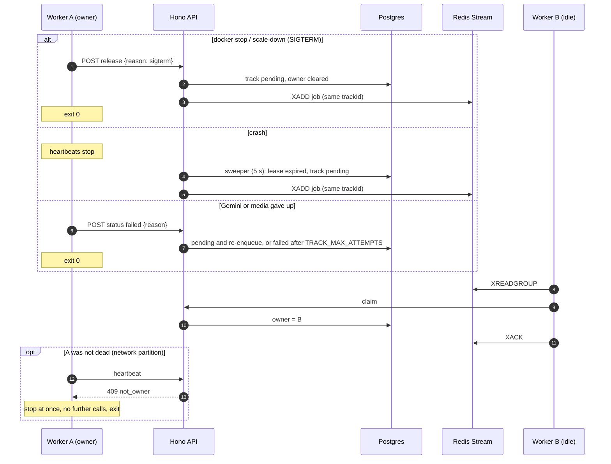
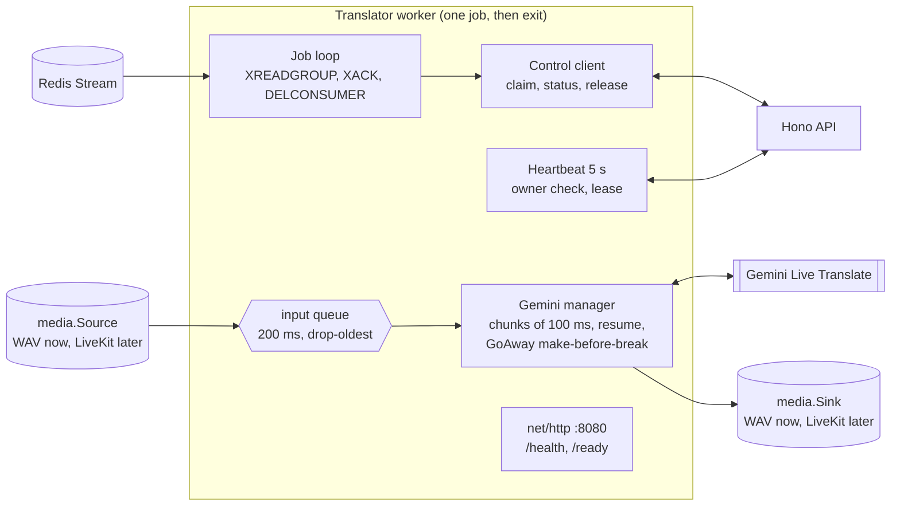
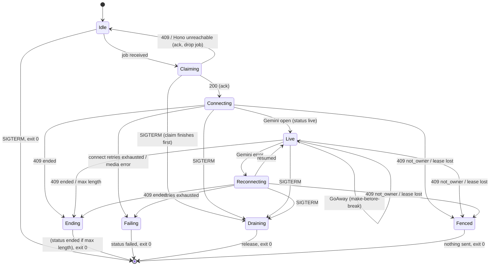

# Translator worker — implementation spec

Project: **AI Dubbing Studio — live dubbing**: a host speaks, and listeners hear a live dub in their chosen language.
This is the design of the **translator worker**, the autoscaled pod that translates one language of one session. It follows ADR-0018 (job dispatch), ADR-0019 (Go runtime) and ADR-0020 (host audio through LiveKit). §9 lists where it fills in or departs from them.

> **This phase** covers the whole job path: the OpenAPI contract, the Go worker, the Redis Stream in Docker Compose, and Hono's leases and internal endpoints.
> **Deferred:** LiveKit (rooms, tokens, the media adapter), Kubernetes (manifests, KEDA, self-delete, `/metrics`), the host's go-live gate in the UI, and captions.
> Until LiveKit lands, host audio comes from a WAV file and the translation is written to a WAV file, behind interfaces the LiveKit adapter will implement.

---

## 1. Decisions

| # | Decision | Why |
|---|---|---|
| D1 | **One process = one job = one session × one language.** | Failure isolation (a crash silences one language), trivial capacity accounting, simple code. |
| D2 | **Go**, standard library HTTP, Gemini through `google.golang.org/genai`. | Low memory per pod (ADR-0019); the official SDK covers Live Translate. |
| D3 | **Single-use workers.** After its job the process exits, and a fresh one takes its place: the Compose restart policy now, a pod self-delete on Kubernetes later (ADR-0018). Idle workers form the warm pool. | No state carries over between tracks. |
| D4 | **No LiveKit secret in the worker.** LiveKit tokens will come from the claim response (ADR-0020). | Least privilege. Deferred with LiveKit. |
| D5 | **Postgres is the source of truth; Redis only delivers.** Hono records the owner (`workerId`) and lease in Postgres. The worker acks the stream message right after the claim answers (200 or 409). There is no `XAUTOCLAIM`; Hono re-enqueues work. | One place owns the track. A long session never looks "abandoned" in Redis. |
| D6 | **Owner check as the fence.** Hono answers `409 not_owner` to any call from a worker that is not the recorded owner; that worker stops at once and exits. | Two workers must never translate the same track. |
| D7 | **Live means ready**: the worker reports `live` once its Gemini stream is open, before any audio. The host waits for every track to be live (ADR-0020). | Audio sent before the workers are ready is lost; waiting for translated audio would deadlock. |
| D8 | **Gemini Live Translate model** (`gemini-3.5-live-translate-preview`) with `TranslationConfig{TargetLanguageCode, EchoTargetLanguage: false}`. The source language is detected automatically. No prompt, no voice activity settings. | A dedicated translation model; it keeps the speaker's voice. |
| D9 | **Two probes** on `net/http`: `/health` and `/ready`. No other inbound API. | Work arrives through the stream. |
| D10 | **Ready ≠ healthy.** *Ready* = idle and waiting on the stream. *Healthy* = its connections work (Redis while idle; lease and Gemini while busy). A busy worker is healthy but not ready. | Ready says who can take work; healthy says whether to restart it. |

---

## 2. System context (this phase)



---

## 3. Sequence diagrams

### 3.1 Session start



### 3.2 Session end

```mermaid
sequenceDiagram
    autonumber
    actor Host
    participant Hono as Hono API
    participant DB as Postgres
    participant W as Worker
    participant Gemini as Gemini Live Translate

    Host->>Hono: POST /sessions/{id}/end
    Hono->>DB: session ended; tracks ended (owner kept)
    W->>Hono: heartbeat
    Hono-->>W: 409 ended
    W->>Gemini: close
    W->>W: drain output (up to 500 ms), close the WAV
    Note over W: no further calls; delete the stream consumer; exit 0
    Note over W: a fresh worker process starts (warm pool)
```

With LiveKit, Hono will also delete the rooms, and the worker will treat the source room closing as the same signal (ADR-0020). The heartbeat `409 ended` remains the backstop.

### 3.3 Failover



---

## 4. Worker design



### 4.1 Lifecycle



`Idle` is the only *ready* state. A rejected claim leaves the worker idle; every other path ends the process.

### 4.2 Concurrency

- `main` owns config, signals, the probe server, and the job loop. The loop reads with `BLOCK 1000` (go-redis does not abort a blocking read on cancel, so a short block keeps idle shutdown at about 1 s).
- A claimed job runs under one context in an `errgroup`: media source, media sink, Gemini manager, heartbeat, max-length timer. The **first** stop cause wins, except *fenced*, which overrides everything.
- **One teardown path:**
    1. Stop the input; the Gemini streams close with the job context.
    2. Let queued translated audio play out for up to 500 ms (not when fenced).
    3. Stop the sink; wait for the goroutines (at most 2 s).
    4. Close the output.
    5. Make the final call on a fresh 3 s context: `release` (SIGTERM), `status failed`, `status ended` (max length), or nothing (ended by Hono, fenced). Any 409 there counts as done.
    6. `main` removes the stream consumer and exits 0.
- **Bounded memory:** the input queue holds 200 ms (drop-oldest, counted in heartbeats); the output buffer holds up to 30 s (drop-oldest).

### 4.3 Media

- `media.Source` delivers 20 ms frames of 16 kHz PCM; `media.Sink` plays 24 kHz PCM at real-time pace.
- **WAV adapter (this phase):**
    - Input comes from `MEDIA_DIR/in/{lang}.wav`, else `in/input.wav`. It is streamed in real time, then silence until the job ends.
    - Output goes to `MEDIA_DIR/out/{sessionId}-{lang}-{workerId}.wav`. The worker id stops a fenced old owner and the new owner from writing one file.
    - Writing starts at the first translated audio. After that, every 20 ms the sink writes audio or silence, so the file lines up with wall-clock time. The header is patched every 5 s.
- **LiveKit adapter (later, ADR-0020):**
    - Join the source room hidden and subscribe-only, as the worker id. Subscribe only to `hostIdentity`'s audio.
    - Join the output room publish-only as `translator-{trackId}` (the shared identity disconnects an old owner). Publish one mono track named `{language}`.

### 4.4 Gemini

- **Client:** `genai.NewClient` with `BackendGeminiAPI` and `HTTPOptions.APIVersion = GEMINI_API_VERSION` (`v1beta`). `Live.Connect(ctx, model, cfg)` with:
    - `ResponseModalities [AUDIO]`
    - `InputAudioTranscription` and `OutputAudioTranscription` both `{}`
    - `TranslationConfig{TargetLanguageCode, EchoTargetLanguage: false}` (the SDK sends it as `setup.generationConfig.translationConfig`)
    - `ContextWindowCompression{SlidingWindow}`
    - `SessionResumption{Handle}`
- **Connect:** the SDK ignores ctx while dialling and waits for `setupComplete`. The worker bounds it to 15 s and closes a late session in the background. Once `Connect` returns the setup is done, so audio can flow at once.
- **Input:** `SendRealtimeInput{Audio: {Data, MIMEType: "audio/pcm;rate=16000"}}` in 100 ms chunks.
- **Output:** `ServerContent.ModelTurn` parts carrying `audio/pcm;rate=24000`.
- **Resumption:** a new handle arrives about every second; the latest resumable one is kept.
- **GoAway — make-before-break:**
    1. Open a new stream with the latest handle while the old one keeps working.
    2. Move the sender to the new stream.
    3. Read the old one for 500 ms more, then close it.
- **Errors:** reconnect with the handle (backoff 500 ms, 1.5 s, 4 s). After a failed attempt with a handle, the next attempt starts fresh. Failures in a row (failed connects, and streams that died within 10 s) are capped at `GEMINI_MAX_RETRIES` (3); past that the job fails.
- **Stalled send:** a send blocked for 5 s closes the stream (no write deadline exists on the SDK's socket), which triggers the reconnect.
- **Transcripts:** logged as metadata at debug level (length, finished, detected language). Text only with `LOG_TRANSCRIPTS=1`. They are never stored (ADR-0002).
- **Measured with `cmd/probe`** (English to Slovak, 2026-11-06):
    - connect takes about 270 ms;
    - the first translated audio arrives about 3 s after the first chunk, about 0.2 s after the source transcript;
    - no `Interrupted` or `TurnComplete` messages;
    - in a 13-minute run, GoAway came at about 9 min with 50 s left; the replacement resumed with the handle in 360 ms, and translated audio continued without a gap (782 s of output for a 783 s run).

---

## 5. Contracts

- **Control API:** [`packages/contracts/openapi/translator-control.yaml`](../../packages/contracts/openapi/translator-control.yaml), OpenAPI 3.0.3. Go types are generated into `internal/control/api` (`go generate`); Hono validates with Zod schemas checked against the generated TypeScript types.
    - `claim`: 200 or `409 owned|ended|unknown_track`. A retried claim by the owner succeeds.
    - `heartbeat`: carries `state` (`connecting|live|reconnecting`) and stats. 200, or `409 not_owner|ended`.
    - `status`: `live`, `ended` (worker-initiated: max length) or `failed` (Hono retries the track until `TRACK_MAX_ATTEMPTS`). A retried final status returns 200.
    - `release`: SIGTERM; Hono re-enqueues at once.
    - Auth is `Authorization: Bearer INTERNAL_API_TOKEN`. Never exposed through a public ingress.
- **Job message:** stream `translate:jobs`, group `translators`. Fields are all strings, no secrets: `v` (`"1"`), `jobId`, `sessionId`, `trackId`, `language` (two letters). A malformed message is acked and dropped.
- **Hono's side:**
    - Table `translation_tracks` (`apps/api/migrations/0001_translation_tracks.sql`), one row per session × language: `status` (`pending|claimed|live|ended|failed`), `worker_id`, `lease_until`, `reason`, `attempts`, `enqueued_at`. Every claim, heartbeat and status is one atomic `UPDATE … WHERE … RETURNING` (`apps/api/src/tracks/repo.ts`), so concurrent claims, and several API instances, get exactly one winner.
    - Each track belongs to one of its session's languages (foreign key to `session_languages`, deleted with the session). `POST /sessions/{id}/start` opens the tracks and sends their jobs; `/end` ends them (`apps/api/src/sessions/service.ts`).
    - A job that can't be sent (Redis down) stays unsent in Postgres (`enqueued_at` null) and is sent by the sweeper.
    - The lease sweeper runs every 5 s: expired leases go back to pending (or failed after `TRACK_MAX_ATTEMPTS`); unsent jobs are sent; a job sent 30 s ago and not claimed is sent again, but only when the stream has no undelivered messages (otherwise it is most likely still waiting for a free worker).
    - It deletes stream consumers idle for over 60 s, every 60 s.
    - It sends the unsent jobs whenever it (re)connects to Redis.

---

## 6. Configuration

Environment variables and defaults are listed in [README.md](README.md#configuration). The required ones are `REDIS_URL`, `CONTROL_API_URL`, `INTERNAL_API_TOKEN` and `GEMINI_API_KEY`.

---

## 7. Running

- **Docker Compose (this phase):**
    - `redis` (AOF on) runs in the default set.
    - `translator` is in the `translator` profile, with 2 replicas, `restart: unless-stopped`, `stop_grace_period: 15s`, a read-only root filesystem, and `media/` mounted.
    - Its healthcheck runs `/translator -healthcheck`, because distroless has no curl.
    - An idle worker that can't reach Redis for `UNHEALTHY_EXIT_SEC` exits, so the restart policy replaces it (Compose doesn't restart unhealthy containers).
- **Image:** `golang:1.27-bookworm` build with `CGO_ENABLED=0` → `gcr.io/distroless/static-debian12:nonroot`, about 41 MB. Revisit when the LiveKit adapter needs libopus.
- **Kubernetes (later):** a Deployment with a self-delete exit hook (`internal/lifecycle`), KEDA scaling on busy pods plus the warm pool, RBAC, and a NetworkPolicy (ADR-0018 follow-ups).

---

## 8. Observability

- JSON logs (`log/slog`). Every job line carries `workerId`, `jobId`, `sessionId`, `trackId` and `language`.
- Heartbeats carry stats to Hono: dropped input frames, output buffer, Gemini reconnects.
- Prometheus metrics come with the Kubernetes phase.

---

## 9. Relation to the ADRs

ADR-0018, ADR-0019 and ADR-0020 are still proposed; ADR-0019 would supersede ADR-0017.

- **Follows:**
    - single-use workers and a warm pool (0018);
    - Go with the standard library and an OpenAPI contract (0019);
    - live means ready (0020).
- **Fills in or departs:**
    1. **Jobs are sent when the session goes live** (**`POST /sessions/{id}/start`**), not when it is created as 0018 and 0020 say, so no worker holds an idle Gemini connection before the host starts.
    2. **`BLOCK 1000`** instead of 5000 (see §4.2).
    3. **The Live Translate model** replaces the earlier native-audio-with-prompt idea.
    4. **`status failed` means "retry me"**: Hono re-enqueues up to `TRACK_MAX_ATTEMPTS`, then marks the track failed. This is the dead-letter handling ADR-0018 asked for.
    5. Until LiveKit, the stop signal is **heartbeat `409 ended`**.

---

## 10. Repository layout

```text
apps/translator/
  go.mod, go.sum, oapi-codegen.yaml, Dockerfile, README.md, pod-spec.md
  cmd/translator/        # main: config, signals, probes, job loop, exit
  cmd/probe/             # real-Gemini check with a WAV file
  internal/config/       # environment
  internal/jobs/         # Redis Stream: group, read, ack, delete consumer
  internal/control/      # Hono client (+ api/: generated types)
  internal/runner/       # one job: state machine, heartbeat, teardown
  internal/gemini/       # Live Translate adapter + stream manager
  internal/media/        # Source/Sink interfaces + WAV adapter
  internal/audio/        # WAV, chunker, bounded buffers
  internal/httpserver/   # /health, /ready
  internal/lifecycle/    # exit hook (Kubernetes self-delete later)
  internal/fakes/        # fake control API, fake Gemini, fake media
  media/in, media/out    # WAV adapter folders (Compose mount)
  scripts/make-test-wav.ps1
packages/contracts/openapi/translator-control.yaml
```

---

## 11. Status

- [x] Contract, Go worker, WAV adapter, Dockerfile, Compose, CI workflow.
- [x] Unit tests (race detector), the Gemini wire-protocol test against a local WebSocket server, and integration tests with real Redis.
- [x] Probe runs against the real Gemini API, including GoAway and resume.
- [x] Hono: migration, Redis client, internal endpoints, sweeper, and a `tracks` command in place of the `/start` and `/end` hooks.
- [x] End-to-end run with Hono and real Gemini through Compose (2026-11-06):
    - A track was claimed as soon as it was opened, live 0.3 s later, and translated audio started about 3 s after that.
    - `docker stop` of the busy worker: released, claimed by the idle worker 21 ms later, live after 280 ms; not counted as an attempt.
    - `docker kill`: another worker took over 13.7 s later (expired lease), counted as one attempt.
    - Ending the session stopped the workers 2 s and 5 s later (their next heartbeat); fresh workers were ready again.
    - Memory: 5.5 MiB idle, 10.7 MiB with a live track; the API 34 MiB.
- [x] Sessions stored; `/start` and `/end` open and end the tracks. From the Studio (2026-11-06): Go live → both tracks claimed 28 ms later, live within 0.5 s, translated audio 3 s later; End session → both workers stopped at their next heartbeat (4.5 s).

## 12. Acceptance criteria (this phase)

- [x] Processes exactly one job, then exits; a rejected claim keeps it idle and waiting.
- [x] A claim 409 acks and drops the message.
- [x] Reports `live` only once the Gemini stream is open.
- [x] `/ready` is 200 only while idle; `/health` stays 200 through a healthy job.
- [x] Heartbeat `409 ended` → stops, makes no further calls, exits.
- [x] Heartbeat `409 not_owner` or a lost lease → stops without calling Hono again.
- [x] SIGTERM during a job → `release`, exit 0; while idle → exit in about 1 s.
- [x] GoAway → stream resumed on a new connection, audio continues; repeated failures → `status failed`.
- [x] Removes its stream consumer on exit; nothing pending is left behind.
- [x] Reads no secret other than `INTERNAL_API_TOKEN` and `GEMINI_API_KEY`; the key is scrubbed from errors.
- [x] Idle memory under 40 MB (5.5 MiB in the end-to-end run).
- [ ] Memory stays flat over a 2-hour session.

## 13. Still to verify

- Gemini Live Translate billing for silence (the worker streams silence until the session ends; `MAX_JOB_MINUTES` caps it).
- LiveKit Go SDK: PCM track options, the auto-subscribe-off option, disconnect reasons; whether Opus needs cgo (affects the image).
- KEDA trigger and the self-delete RBAC (Kubernetes phase).
