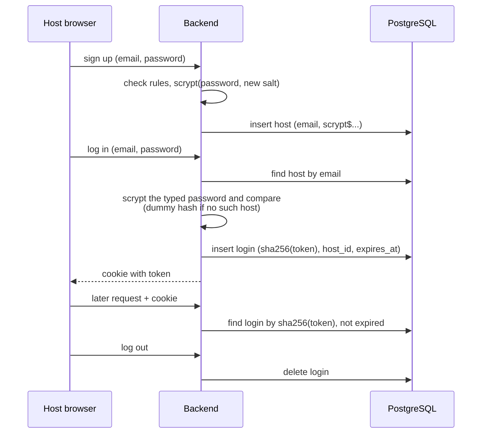

# 0003. How hosts sign up, log in and stay logged in

- **Status:** Proposed
- **Date:** 2026-10-27
- **Deciders:** Jamie
- **Ticket:** YGP-12

## Context

Today there is one host account, hard-coded in environment variables. Logging in
gives the browser a signed cookie that holds only an expiry time (12 hours); the
server stores nothing. ADR-0002 adds a `hosts` table so anyone can sign up.

A host login matters because hosts start **paid Gemini streams** (one per target
language). A stolen or guessed login can spend real money.

Constraints:

- Only hosts log in. Listeners are anonymous, so logins grow with the number of
  hosts, not listeners.
- A live session can last up to 4 hours (`MAX_SESSION_MINUTES`), so a login must
  outlast it.
- Data lives in the PostgreSQL database from ADR-0002.
- The backend runs Node 22 (`node:22-alpine`).
- No email sending in the prototype, so no email verification or password reset.

## Options considered

### A. How the server remembers a login

1. **Signed cookie** (today's approach, plus the host id).
    - Pros: no database lookup; already mostly built; scales easily, because any
      backend instance can check it alone.
    - Cons: **can't be cancelled**. Logging out only deletes the cookie from that
      browser; a copied cookie works until it expires, and a password change
      doesn't end other logins.

2. **Server-side login table**: the cookie holds a long random token, and a
   `logins` table records which host it belongs to and when it expires.
    - Pros: logout ends the login everywhere; "log out all devices" and "end all
      logins on password change" are one `DELETE`.
    - Cons: one more table and expired rows to clean up; one database lookup per
      logged-in request.

### B. How passwords are hashed

All three are slow on purpose and use a per-user salt, so a leaked database is
expensive to crack by guessing.

1. **bcrypt** (1999).
    - Pros: widely used and well understood.
    - Cons: uses CPU only (not memory-hard), so graphics cards guess it cheaply;
      ignores everything after 72 bytes of a password; needs an npm package.

2. **scrypt** (2009).
    - Pros: memory-hard; on OWASP's recommended list; **built into Node 22**
      (`node:crypto`), so nothing to install.
    - Cons: settings are less obvious, and Node's defaults are too weak (measured below).

3. **Argon2id** (2015, winner of the Password Hashing Competition).
    - Pros: OWASP's first choice; the strongest memory-hardness.
    - Cons: not built into Node 22. It needs an npm package with native code
      (extra build steps on Alpine) or an upgrade to Node 24.

## Measurements

scrypt timed on the development laptop (Intel i7-1355U), 2026-10-27:

| Setting | Memory per hash | Time per hash | OWASP |
|---|---|---|---|
| N=2^14, r=8, p=1 (Node default) | 16 MiB | ~82 ms | Below minimum |
| N=2^16, r=8, p=2 | 64 MiB | ~660 ms | Meets |
| N=2^17, r=8, p=1 | 128 MiB | ~670 ms | Meets |

## Decision

We will remember logins in a **server-side login table** (option A2) and hash
passwords with **scrypt** (option B2).

Why:

- **Login table:** being able to end a login protects paid Gemini usage. The extra
  lookup is negligible because only hosts log in, and the table lives in the
  PostgreSQL we already run, so more backend instances still work.
- **scrypt:** memory-hard and OWASP-recommended, and built into the Node version we
  already run, so it needs no extra dependency. Argon2id is stronger, but needs a
  native package or Node 24 (see Consequences).

### Logins

- On login, the server creates a random 32-byte token and sends it in the cookie
  (`HttpOnly`, `SameSite=Lax`, `Secure` in production).
- The `logins` table stores a **SHA-256 hash of the token**, never the token, plus
  `host_id`, `created_at` and `expires_at`. A leaked table can't be used as cookies.
  A fast hash is fine here: the token is long and random, so there is nothing to guess.
- A login lasts **12 hours, fixed** (not extended by activity). This outlasts the
  longest live session (4 hours).
- Logout deletes the row. A password change deletes all of that host's rows.

### Passwords

- scrypt with **N=2^16, r=8, p=2** (64 MiB, ~660 ms on the development laptop), a
  random 16-byte salt per host and a 32-byte result. Node's default setting is
  below the OWASP minimum, so it is not used.
- Stored with its settings in one field, `scrypt$N$r$p$salt$hash`, so the method
  can change later (see Consequences).
- Rules: **12 to 128 characters**, any characters (including spaces), no forced
  symbols or numbers, no forced expiry, and a short list of very common passwords
  is refused. 12 follows OWASP ASVS v4; 15 (NIST, single-factor) was judged too
  strict for a prototype that also has a slow hash, rate limits and logins that
  can be ended.

### Errors and limits

- Login failures always say **"Email or password is incorrect."** When the email
  doesn't exist, the server still hashes a dummy value, so both cases take the same
  time and the delay reveals nothing.
- Sign-up with an existing email says it is already registered. Hiding this needs
  email verification, which is out of scope; the rate limit stops mass checking.
- Rate limits (as settings, so they can be tuned):
    - login: 5 per minute per IP (as today), and 10 per 15 minutes per email;
    - sign-up: 10 per hour per IP (allows a small group on one shared network).

### How it works

## Consequences

Good:

- A login can be ended at any time: logout, "log out all devices" and a password
  change all take effect immediately, which protects paid Gemini usage.
- A leaked `logins` table can't be used to log in (only token hashes are stored),
  and a leaked `hosts` table is slow and memory-hungry to crack.
- No new dependencies: scrypt and SHA-256 are both in `node:crypto`.

Bad / trade-offs:

- One extra database lookup per logged-in request (small, as only hosts log in).
- Each login or sign-up costs about 660 ms of CPU and 64 MiB of memory. The rate
  limits keep this from being used to overload the server.
- The rate limits are kept in memory, so they reset on restart and aren't shared
  between backend instances. Fine for one instance; a shared store (e.g. the
  database) is needed before running more.
- No email verification or password reset, so a forgotten password needs manual help.

Follow-up work:

- Add the `logins` table to the database schema (YGP-11).
- Delete expired `logins` rows in the daily clean-up job from ADR-0002.
- Revisit Argon2id when the backend moves to Node 24; the stored
  `scrypt$...` format lets old hashes be upgraded at next login.
- Make the rate limits settings rather than fixed values.
