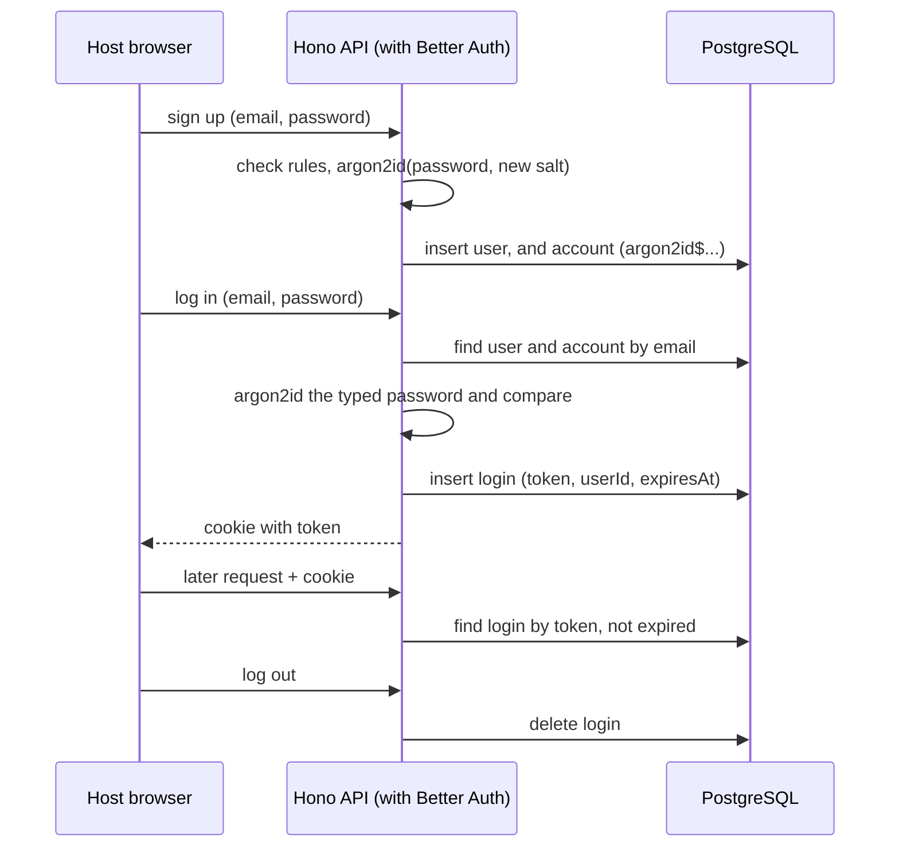

# 0003. How hosts sign up, log in and stay logged in

- **Status:** Proposed
- **Date:** 2026-10-29
- **Deciders:** Jamie, Marek
- **Ticket:** YGP-12

## Context

Today there is one host account, hard-coded in environment variables. Logging in
gives the browser a signed cookie that holds only an expiry time (12 hours); the
server stores nothing. ADR-0002 adds a database so anyone can sign up.

A host login matters because hosts start **paid Gemini streams** (one per target
language). A stolen or guessed login can spend real money.

Constraints:

- Only hosts log in. Listeners are anonymous, so logins grow with the number of
  hosts, not listeners.
- A live session can last up to 4 hours (`MAX_SESSION_MINUTES`), so a login must
  outlast it.
- Data lives in the PostgreSQL database from ADR-0002.
- The backend moves from Fastify to Hono (ADR-0007). It runs Node 22 today
  (`node:22-alpine`).
- No email sending in the prototype, so no email verification or password reset.

## Options considered

### A. How the server remembers a login

1. **Signed cookie** (today's approach, plus the host id).
    - Pros: no database lookup; already mostly built; scales easily, because any
      backend instance can check it alone.
    - Cons: **can't be cancelled**. Logging out only deletes the cookie from that
      browser; a copied cookie works until it expires, and a password change
      doesn't end other logins.

2. **Server-side login table**: the cookie holds a long random token, and a
   table records which host it belongs to and when it expires.
    - Pros: logout ends the login everywhere; "log out all devices" and "end all
      logins on password change" are one `DELETE`.
    - Cons: one more table and expired rows to clean up; one database lookup per
      logged-in request.

### B. How passwords are hashed

All three are slow on purpose and use a per-user salt, so a leaked database is
expensive to crack by guessing.

1. **bcrypt** (1999).
    - Pros: widely used and well understood.
    - Cons: uses CPU only (not memory-hard), so graphics cards guess it cheaply;
      ignores everything after 72 bytes of a password; needs an npm package.

2. **scrypt** (2009).
    - Pros: memory-hard; on OWASP's recommended list; built into Node 22
      (`node:crypto`).
    - Cons: settings are less obvious, and Node's defaults are too weak (measured below).

3. **Argon2id** (2015, winner of the Password Hashing Competition).
    - Pros: OWASP's first choice; the strongest memory-hardness; built into
      `node:crypto` from Node 24, so nothing to install.
    - Cons: needs the backend image moved from Node 22 to Node 24 or later.

### C. Build it ourselves or use a library

1. **Build it ourselves**: our own login table, token hashing, password rules and
   rate limits (the first draft of this ADR).
    - Pros: full control, for example storing only a hash of each login token.
    - Cons: several days of security-sensitive code and tests before the
      prototype deadline; small mistakes are easy to make and hard to spot.

2. **Better Auth**: a TypeScript authentication library with email and password
   sign-in, sessions stored in the database, and built-in rate limits.
    - Pros: a Hono integration (ADR-0007); works with PostgreSQL and creates its
      own tables; password reset is ready for when email sending exists; actively
      maintained, so bugs are found and fixed by others.
    - Cons: one more dependency to keep up to date; its defaults differ from our
      requirements and must be configured; it stores login tokens unhashed (see
      Consequences).

## Measurements

Password hashing timed on the development laptop (Intel i7-1355U).

scrypt, 2026-10-27:

| Setting | Memory per hash | Time per hash | OWASP |
|---|---|---|---|
| N=2^14, r=8, p=1 (Node default) | 16 MiB | ~82 ms | Below minimum |
| N=2^16, r=8, p=2 | 64 MiB | ~660 ms | Meets |
| N=2^17, r=8, p=1 | 128 MiB | ~670 ms | Meets |

Argon2id, 2026-10-29 (Node 24.11, `crypto.argon2Sync`):

| Setting | Memory per hash | Time per hash | OWASP |
|---|---|---|---|
| m=19 MiB, t=2, p=1 | 19 MiB | ~128 ms | Minimum |
| m=46 MiB, t=1, p=1 | 46 MiB | ~196 ms | Meets |
| m=64 MiB, t=3, p=4 (RFC 9106) | 64 MiB | ~368 ms | Meets |

## Decision

We will use **Better Auth** (option C2), configured to keep logins in the
database (option A2) and to hash passwords with **Argon2id** (option B3).

Why:

- **Better Auth:** it gives us a tested login system that fits Hono and
  PostgreSQL, so the prototype time goes into the dubbing itself. Our own
  requirements below become its configuration.
- **Login table:** being able to end a login protects paid Gemini usage. The extra
  lookup is negligible because only hosts log in, and the table lives in the
  PostgreSQL we already run, so more API instances still work.
- **Argon2id:** stronger than scrypt and, at the setting we chose, also faster
  (~368 ms against ~660 ms). It only needs the Node upgrade, which the Hono
  rewrite is a good moment for.

### Logins

- Better Auth's session table holds each login, renamed to `logins`
  (`session.modelName`) so "session" keeps meaning a live event. The cookie
  holds its token (`HttpOnly`, `SameSite=Lax`, `Secure` in production).
- A login lasts **12 hours, fixed** (`session.expiresIn`, with
  `disableSessionRefresh` so activity doesn't extend it). This outlasts the
  longest live session (4 hours).
- Logout ends that login. A password change ends the host's other logins
  (`revokeOtherSessions`, which is off by default) and keeps the current one.

### Passwords

- Argon2id with **m=64 MiB, t=3, p=4** (~368 ms on the development laptop), a
  random 16-byte salt per host and a 32-byte result, plugged in through Better
  Auth's `password.hash` and `password.verify` options.
- Stored with its settings in one field, `argon2id$m$t$p$salt$hash`, so the
  setting can change later and old hashes can be upgraded at next login.
- Rules: **12 to 128 characters**, any characters (including spaces), no forced
  symbols or numbers, no forced expiry, and a short list of very common passwords
  is refused. 12 follows OWASP ASVS v4; 15 (NIST, single-factor) was judged too
  strict for a prototype that also has a slow hash, rate limits and logins that
  can be ended.

### Errors and limits

- Login failures always say **"Email or password is incorrect."**, whether the
  email exists or not.
- Sign-up with an existing email says it is already registered. Hiding this needs
  email verification, which is out of scope; the rate limit stops mass checking.
- Rate limits use Better Auth's `customRules`, stored in the database so they
  are shared between API instances:
    - login: 5 per minute per IP (as today);
    - sign-up: 10 per hour per IP (allows a small group on one shared network).

### How it works

## Consequences

Good:

- A login can be ended at any time: logout, "log out all devices" and a password
  change (for the host's other logins) all take effect immediately, which protects
  paid Gemini usage.
- A leaked database is slow and memory-hungry to crack for passwords.
- Much less security code of our own to write and test.
- Rate limits are shared between API instances, because they live in the
  database.

Bad / trade-offs:

- **Login tokens are stored unhashed.** Better Auth saves and looks up the session
  token as it is, so someone with a copy of the `logins` table could use its
  tokens to log in. The 12-hour limit caps how long a stolen token works, and
  anyone with a copy of the database already has more serious access. Accepted
  for the prototype.
- One extra database lookup per logged-in request (small, as only hosts log in).
- Each login or sign-up costs about 370 ms of CPU and 64 MiB of memory. The rate
  limits keep this from being used to overload the server.
- The earlier per-email login limit (10 per 15 minutes) is dropped: Better Auth
  limits per IP and path.
- No email verification or password reset, so a forgotten password needs manual help.

Follow-up work:

- Move the Hono API image to Node 24 or later (Marek suggested Node 26) as part of
  the Hono rewrite.
- Write our own check for the common-password list; Better Auth's password options
  only set the length.
- Set the IP header Better Auth reads behind our proxy, as it doesn't trust
  comma-separated forwarded chains by default, and turn rate limits on wherever we
  test them, as they default to on only in production.
- Check that the login failure message can be set to the wording above.
- Check whether Better Auth deletes expired sessions; if not, add them to the
  daily clean-up job from ADR-0002.
- Check that a failed login takes the same time whether the email exists or not;
  if not, hash a dummy value for unknown emails.
- Turn on password reset once the project can send email.
