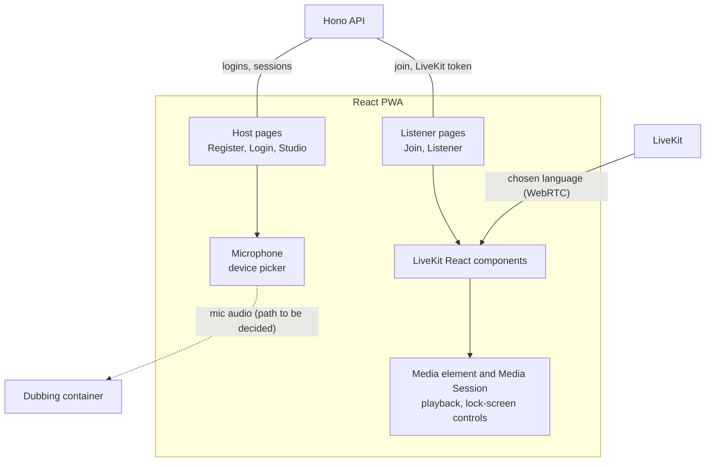
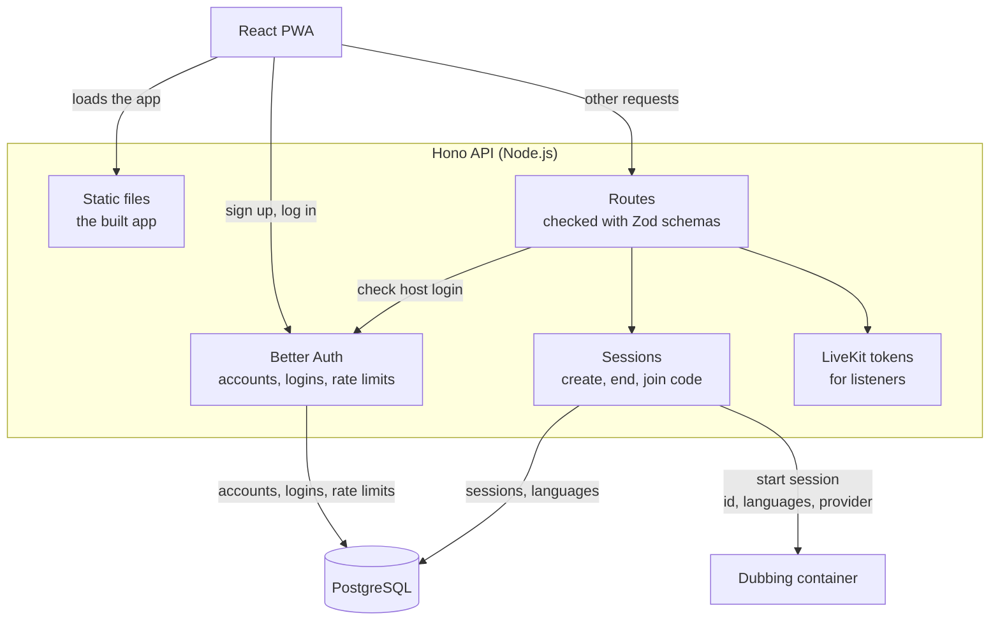
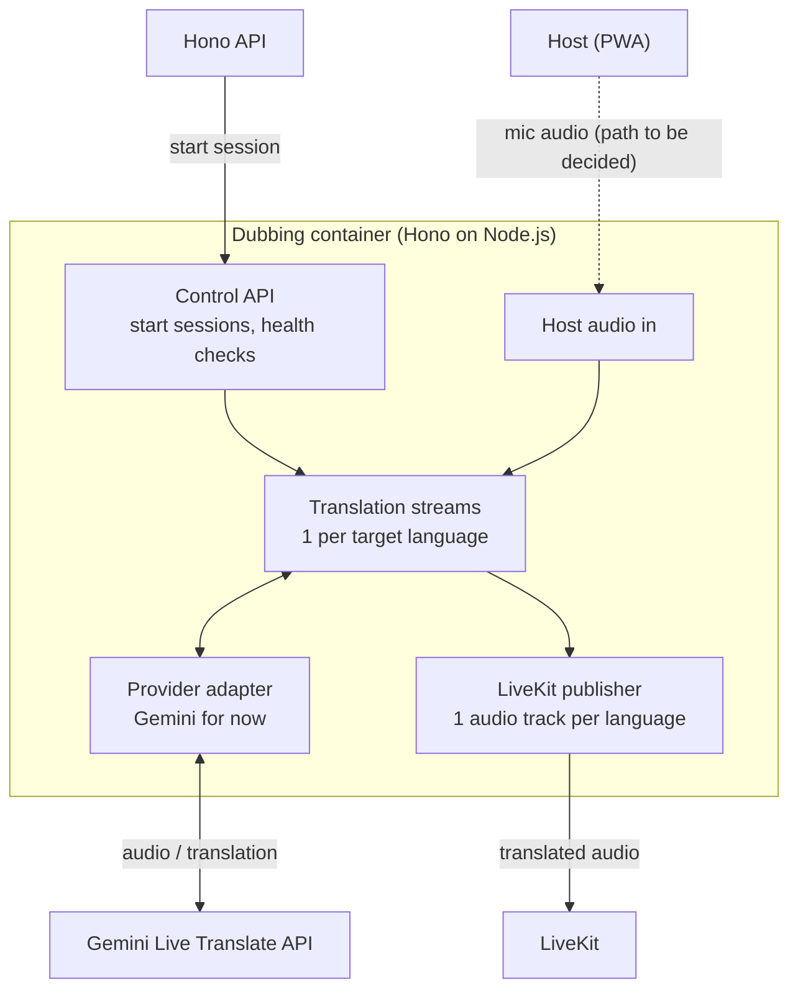
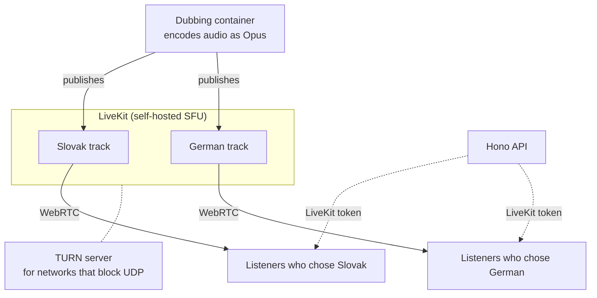

# Architecture layers

A closer look at each part of the [target architecture](architecture.md). Like that
page, this is the design for the final prototype, and it isn't built yet.

## App

One React PWA for hosts and listeners, served by the Hono API
([ADR-0012](adr/0012-serving-pwa-bundle.md)). Hosts log in; listeners never need
an account. The app has five pages ([ADR-0014](adr/0014-pages.md)), and no offline
mode, because live audio needs the network anyway
([ADR-0010](adr/0010-mobile-native.md)).

Playing audio on a locked phone is a target, not a guarantee
([ADR-0011](adr/0011-audio-handling.md)). How captions reach the Listener page is
still to be decided.

## API

The Hono API handles logins and sessions, and serves the app
([ADR-0007](adr/0007-backend-framework.md)). It is kept small so it can scale
quickly when many listeners join at once, separate from the long-lived audio
streams in the dubbing container ([ADR-0008](adr/0008-separated-container.md)).

The request to the dubbing container is defined in
[ADR-0009](adr/0009-translation-engine-communication.md), and the shared schemas
in [ADR-0016](adr/0016-schema-validator.md). Still open: how Hono calls the
dubbing container, and what it does when the container is unavailable.

## Dubbing container

The dubbing container takes the host's audio, keeps one translation stream per
target language, and publishes one audio track per language to LiveKit. It also
runs Hono on Node.js ([ADR-0017](adr/0017-translation-plane.md)). Each provider
sits behind an adapter, and the request that starts a session names which one to
use ([ADR-0009](adr/0009-translation-engine-communication.md)). Gemini is the only
provider for now.

Still open: how the container verifies the host, and how captions leave it.

## Media

A self-hosted LiveKit SFU delivers the translated audio
([ADR-0001](adr/0001-audio-fan-out.md)). It receives each language's track once
and forwards it over WebRTC only to the listeners who chose that language, so the
dubbing container's load doesn't grow with the number of listeners. Slovak and
German are examples here.

TURN needs setting up before the app runs on a public server. Still open: whether
LiveKit rooms are per session or per language.
