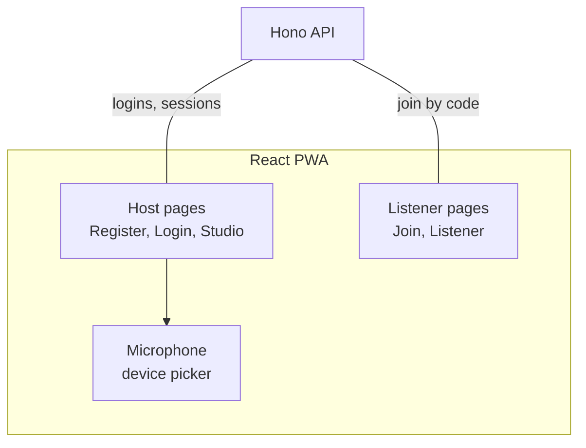
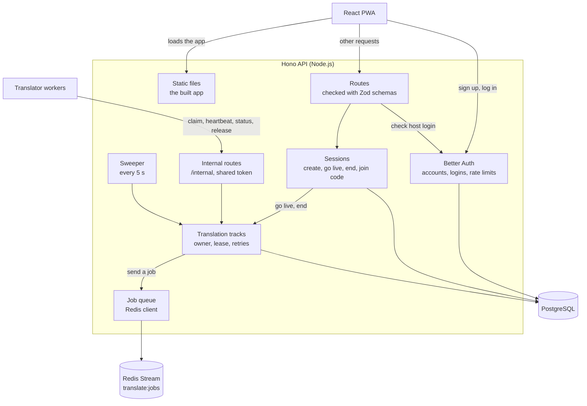
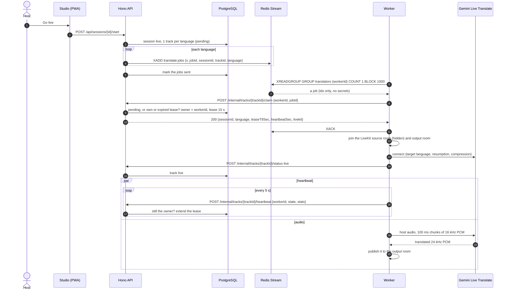
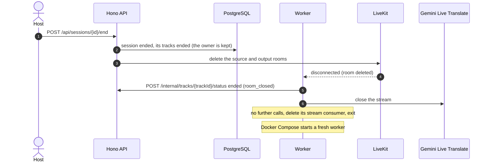
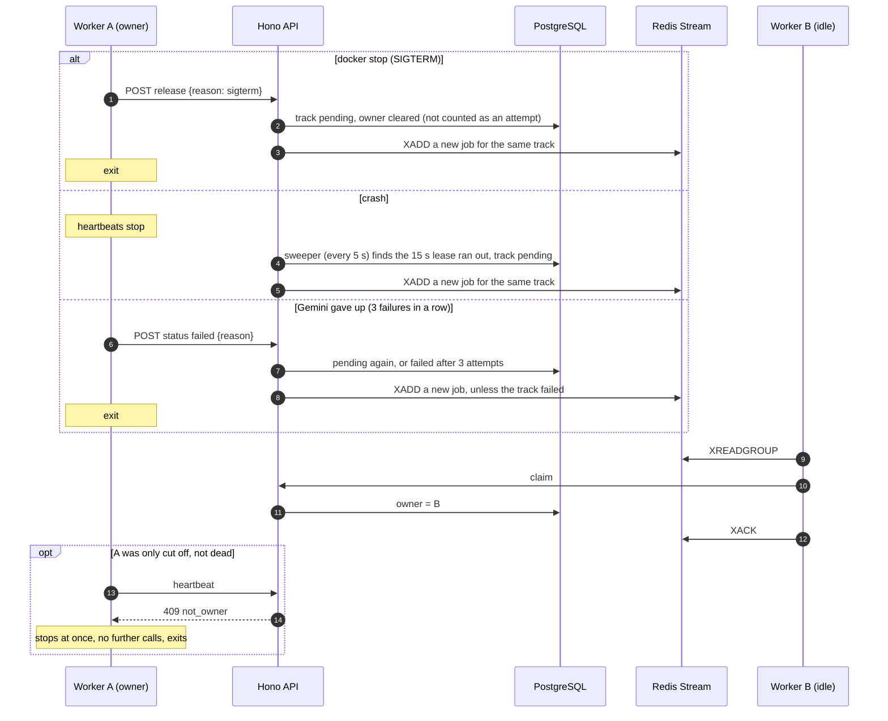
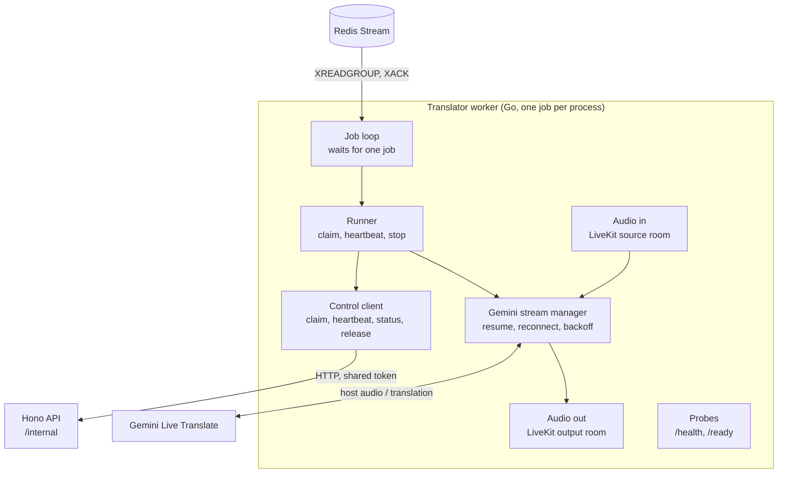
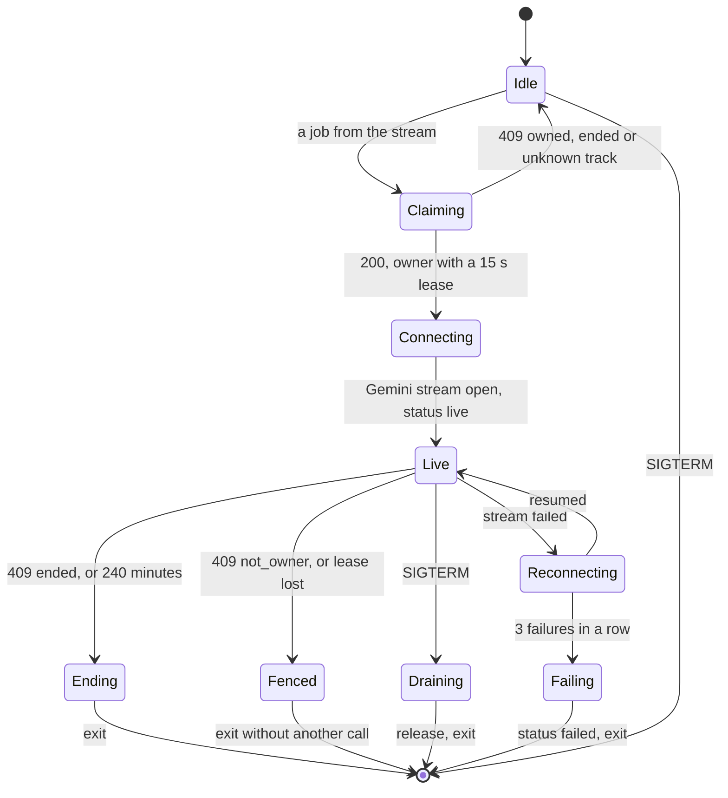

# Architecture layers

A closer look at each part of the [architecture](architecture.md): the app, the
API, how jobs reach the translator workers, the workers themselves, and their
audio files.

## App

One React PWA for hosts and listeners, served by the Hono API
([ADR-0012](adr/0012-serving-pwa-bundle.md)). Hosts log in; listeners never need
an account. The app has five pages ([ADR-0014](adr/0014-pages.md)), and no offline
mode, because live audio needs the network anyway
([ADR-0010](adr/0010-mobile-native.md)).

- **Built:** all five pages against the real API. A host registers, logs in,
  creates a session, shares its code, takes it live and ends it. A listener
  finds a session by its code and picks a language.
- The Studio's microphone picker only tests the input, and the listener page
  shows that listening isn't available yet.

## API

The Hono API handles logins and sessions, serves the app, and hands each live
session's languages to the translator workers
([ADR-0007](adr/0007-backend-framework.md),
[ADR-0018](adr/0018-autoscaling-architecture-of-translation-container.md)). It
stays small and quick to scale, apart from the long-lived audio streams in the
workers ([ADR-0008](adr/0008-separated-container.md)).

- **Sessions** are stored in Postgres ([ADR-0002](adr/0002-session-and-account-storage.md)).
  Going live opens one translation track per target language; ending the
  session ends its tracks. A host only ever sees their own sessions.
- **Translation tracks** record which worker owns each language and until when
  (its lease). Every change is one SQL `UPDATE`, so when two workers claim the
  same track at once, exactly one wins, even with several API instances.
- **Internal routes** are what the workers call: claim, heartbeat, status and
  release, behind a token shared with the workers. Their contract is the
  OpenAPI document `packages/contracts/openapi/translator-control.yaml`
  ([ADR-0019](adr/0019-translation-worker-runtime.md)); the [API page](api.md)
  lists them.
- **The sweeper** runs every 5 seconds and keeps tracks moving when something
  goes wrong (see [Job dispatch](#job-dispatch)).
- The shared request schemas are in [ADR-0016](adr/0016-schema-validator.md).

## Job dispatch

The API puts one job per language on the Redis Stream `translate:jobs`, and the
idle workers read it as one consumer group (`translators`), so each job goes to
exactly one worker ([ADR-0018](adr/0018-autoscaling-architecture-of-translation-container.md)).
A job holds only ids: `v`, `jobId`, `sessionId`, `trackId` and `language`; no
secrets.

Redis only delivers. Postgres, through the API, decides who owns a track:

- A worker acknowledges the job as soon as the API answers its claim, with
  `200` or `409`. So the stream never holds work in progress.
- A job sent twice is harmless: the second worker's claim gets `409 owned`, and
  it drops the job.
- A job that can't be sent (Redis is down) stays marked unsent in Postgres. The
  sweeper sends it once Redis is back, and the API sends all of them when it
  reconnects.
- A job sent but never claimed (a worker died between reading and claiming) is
  sent again after 30 seconds, but only when the stream has no undelivered
  messages. While messages wait for a free worker, it is most likely among them.
- The sweeper deletes the stream consumers of workers that stopped, every
  minute.

### A session goes live

In Docker Compose each language was claimed 28 ms after **Go live** and live
1 to 2 seconds after the claim, once its worker had joined both LiveKit rooms;
the first translated speech followed about 3 seconds later.

### A session ends

The workers stopped 0.3 seconds after **End session**. Without LiveKit, or if
a worker misses the room deletion, its next heartbeat gets `409 ended` (within
5 seconds) and it stops the same way.

Keeping the owner on an ended track lets that worker's retried final report
still get `200`, while any other worker gets `409 ended`.

### A worker fails

Measured in Docker Compose: after `docker stop` the other worker claimed the
track 21 ms later and was live 280 ms after that; after `docker kill` another
worker took over about 14 seconds later, once the lease ran out.

## Translator worker

The worker is written in Go with no web framework
([ADR-0019](adr/0019-translation-worker-runtime.md)), in `apps/translator`. One
process takes **one job**: one target language of one session. It then exits,
and Docker Compose starts a fresh one, so nothing carries over between tracks.
The idle workers waiting on the stream are the warm pool.

- **Gemini Live Translate** (`gemini-3.5-live-translate-preview`): the worker
  sets only the target language; Gemini detects the spoken language. It reports
  `live` as soon as the stream is open, before any audio.
- **Reconnects:** Gemini asks for a new connection about every 9 minutes. The
  worker opens the new one first, resumes with Gemini's handle, then closes the
  old one; this took 360 ms with no gap in the audio. A failed stream is retried
  after 0.5, 1.5 and 4 seconds; after 3 failures in a row the worker reports
  `failed`.
- **Stopping:** `409 ended` (the session ended), `409 not_owner` or a lost lease
  (another worker has the track: stop without another call), SIGTERM (give the
  track back), or 240 minutes on one track (a spend guard).
- **Probes:** `/health` says its connections work (Redis while idle; the lease
  and Gemini while busy). `/ready` says it is idle and waiting for a job.
- **Media:** host audio comes in and translated audio goes out through two
  interfaces. The LiveKit adapter (`internal/livekit`) joins the source room
  hidden and listen-only and publishes one track named after the language in
  the output room, with the tokens from the claim. When the claim carries no
  LiveKit access, a WAV adapter is used (`apps/translator/media/in` and
  `out`). A deleted room ends the track; another participant joining with the
  worker's identity stops it like a `409 not_owner`.
- **Size:** 5.5 MiB of memory idle, 10.7 MiB with a live track (measured with
  the WAV adapter). The image is about 188 MB unpacked, on Debian with libopus
  and libsoxr for the LiveKit adapter.

### Worker lifecycle

Ending, Fenced and Draining can follow any busy state, not only Live. A claim
that gets `409` leaves the worker idle, still waiting.

## Audio

Each worker hears the host in the session's LiveKit source room and publishes
its translation into its language's output room. Only when the API has no
LiveKit settings does it read the host's audio from a WAV file in
`apps/translator/media/in` and write its translation to
`apps/translator/media/out`.
