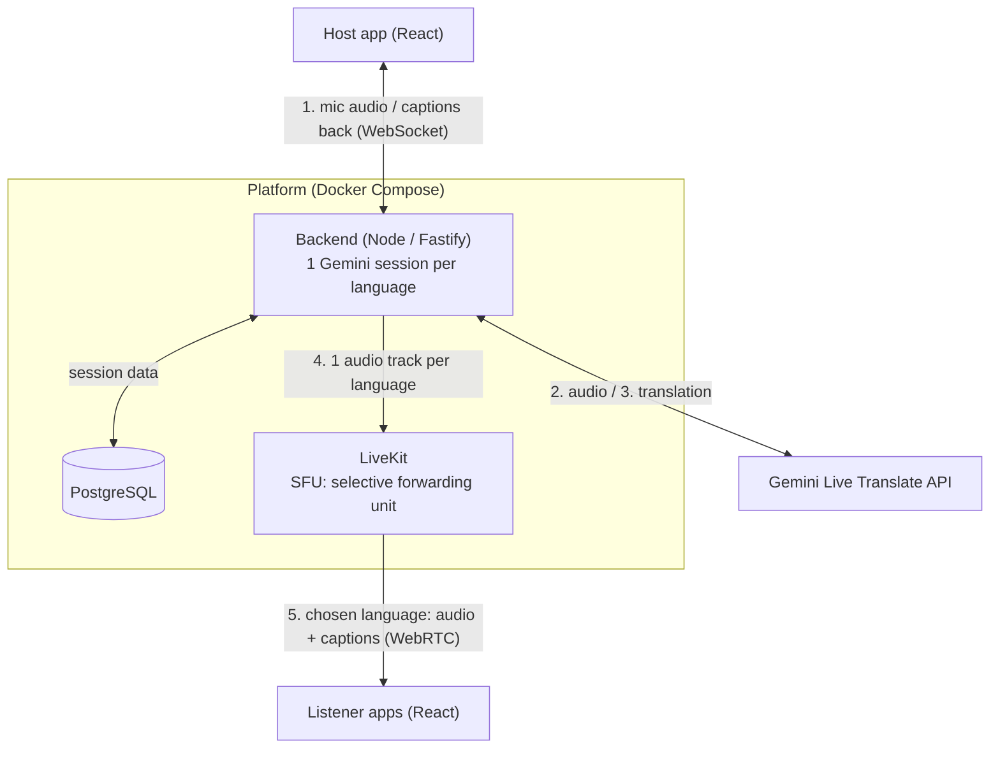
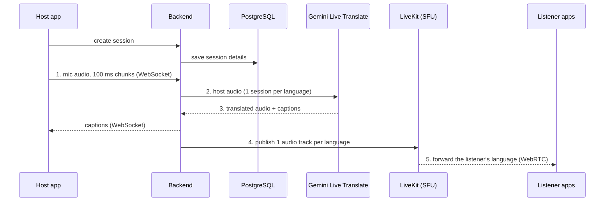

# Architecture

This is the **target architecture for the final prototype**. The choice of LiveKit
and PostgreSQL is being recorded in the [decision records](adr/index.md).

## Overview

The host speaks once; every listener hears them in their chosen language.
The backend holds **one Gemini session per target language** and publishes one
audio track per language to LiveKit, which forwards each listener only the
language they picked. Cost grows with the number of languages, not listeners.

## Step by step

An **SFU (selective forwarding unit)** receives each audio track once and forwards
it to every listener who subscribed to it, without decoding or mixing. Listeners
connect to it over **WebRTC**, which is built for real-time media.
