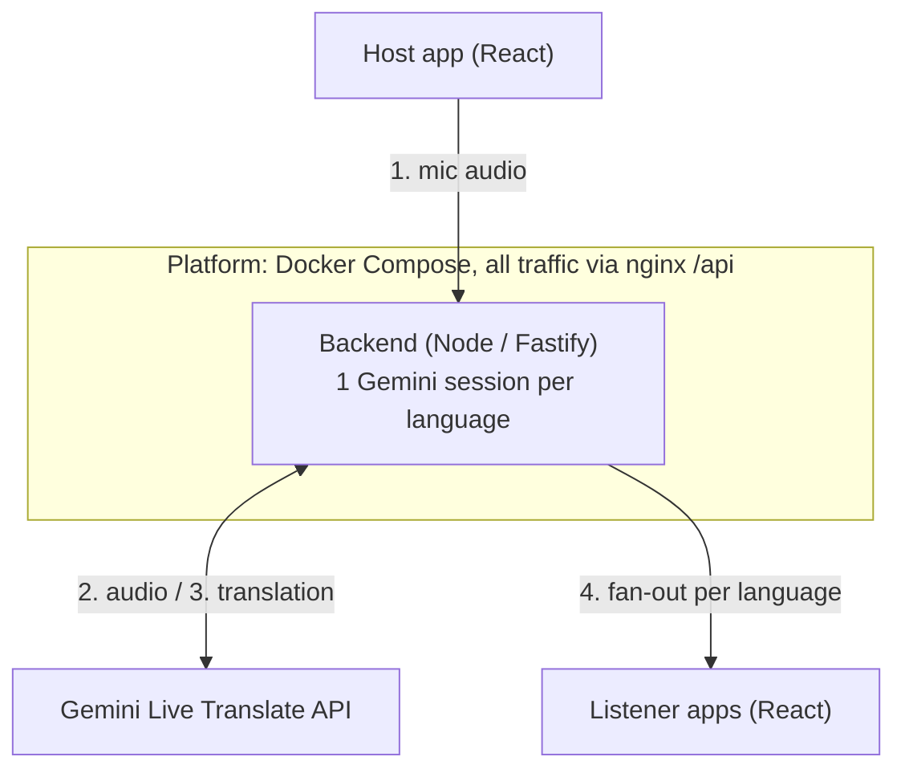
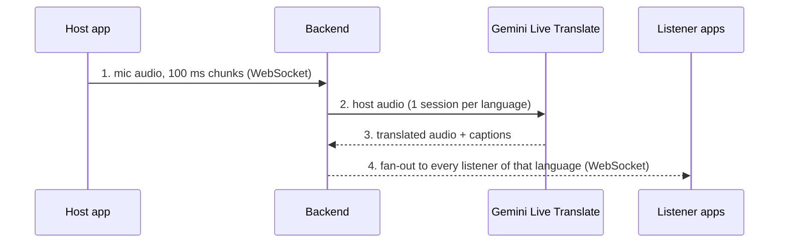

# Architecture

How live audio flows from the host to listeners in the current proof of concept.

## Overview

The host speaks once; every listener hears them in their chosen language.
All browser traffic goes through nginx at `/api`. The backend holds
**one Gemini session per target language**, shared by every listener of that language,
so cost grows with the number of languages, not listeners.

## Step by step

**Fan-out** (step 4) is where the backend copies each language's audio to every
listener of that language. It is the part a selective forwarding unit (SFU) such
as LiveKit would replace; see the [decision records](adr/index.md).
