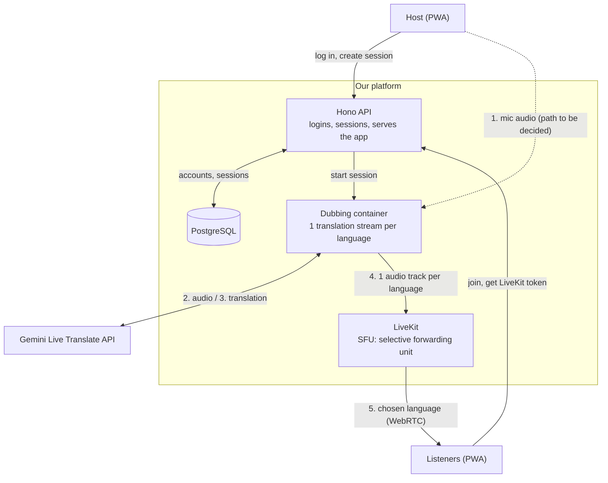
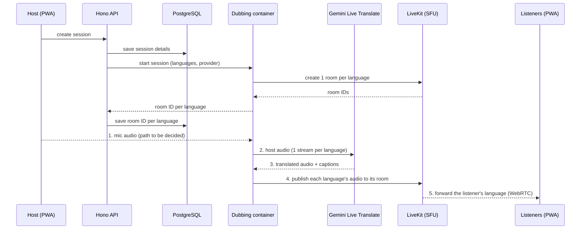
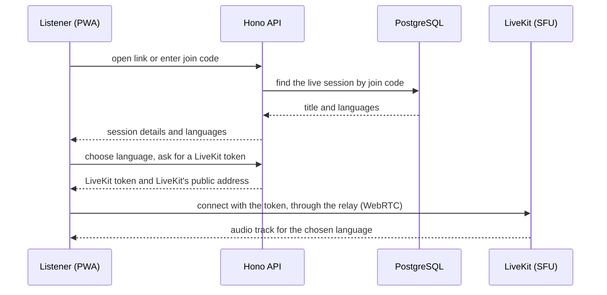
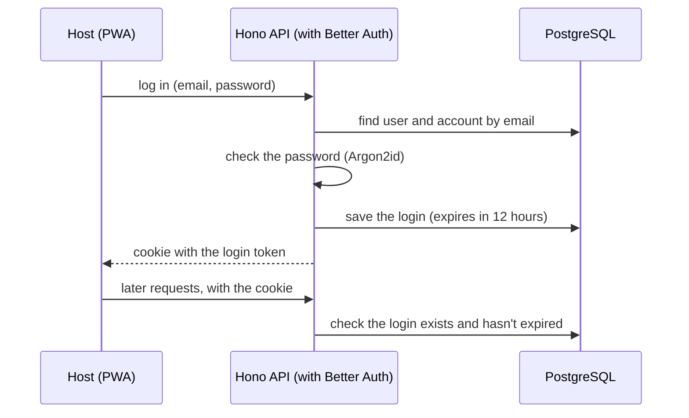
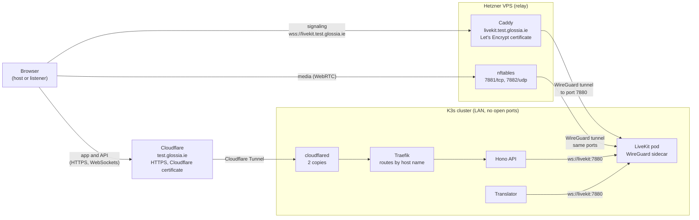
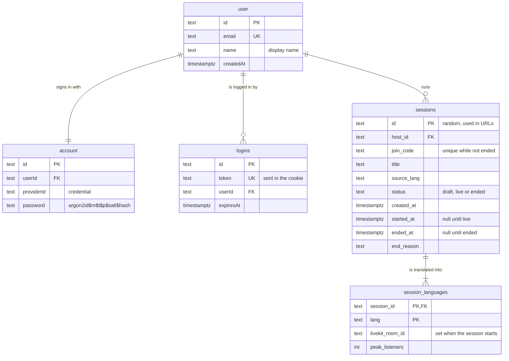

# Architecture

This is the **target architecture for the final prototype**. It isn't built yet:
the [Setup Guide](setup-guide.md) and [API](api.md) describe the app as it works
today. The reasons for each choice are in the [decision records](adr/index.md).

## Overview

The host speaks once; every listener hears them in their chosen language.

- The **Hono API** handles logins and sessions, stores them in PostgreSQL, and
  serves the app.
- The **dubbing container** holds **one translation stream per target language**,
  using Gemini, and publishes one audio track per language to LiveKit.
- **LiveKit** forwards each listener only the language they picked.

Cost grows with the number of languages, not listeners.

**Still to be decided:** how the host's mic reaches the dubbing container, how
captions reach listeners once audio moves to LiveKit (today they use the
WebSocket), whether the prototype runs on Docker Compose or Kubernetes, and how
the dubbing container verifies the host.

For more detail on each part, see [Architecture layers](architecture-layers.md).

## Step by step

An **SFU (selective forwarding unit)** receives each audio track once and forwards
it to every listener who subscribed to it, without decoding or mixing. Listeners
connect to it over **WebRTC**, which is built for real-time media.

### A listener joins

Listeners have no account. They only need the join code. On test, the listener
reaches the API at `test.glossia.ie` and LiveKit at `livekit.test.glossia.ie`,
through the relay (see [Networking](#networking-test)).

### A host logs in

The details are in [ADR-0003](adr/0003-host-authentication.md).

## Networking (test)

This part runs today on the test environment. The cluster sits on a LAN with no
open ports, so browsers reach it by two public paths, both dialled out from
inside the cluster:

- **The app and the API** at `test.glossia.ie`, through a Cloudflare Tunnel.
- **LiveKit** at `livekit.test.glossia.ie`, through a Hetzner VPS (the relay)
  and a WireGuard tunnel ([ADR-0023](adr/0023-livekit-public-endpoint.md)).

- **Cloudflare** ends HTTPS and passes requests, WebSockets too, through the
  tunnel that `cloudflared` keeps open from the cluster. Traefik sends each
  host name to its environment's API (YGP-92).
- **The relay** serves LiveKit's signaling through Caddy and forwards media on
  UDP 7882 and TCP 7881. LiveKit tells browsers to send media to the relay's
  address. The WireGuard sidecar dials out to the relay, so the tunnel follows
  the pod to whichever node it runs on.
- **Inside the cluster** the API and the translator reach LiveKit directly at
  `ws://livekit:7880`, without going through the relay.

The [Deployment page](deployment.md#livekits-public-address-test) has the
details of the relay.

## Why it's built this way

| Part | Decision |
|---|---|
| LiveKit for listener audio | [ADR-0001](adr/0001-audio-fan-out.md) |
| PostgreSQL | [ADR-0002](adr/0002-session-and-account-storage.md) |
| Host logins | [ADR-0003](adr/0003-host-authentication.md) |
| Hono for the API | [ADR-0007](adr/0007-backend-framework.md) |
| Separate dubbing container | [ADR-0008](adr/0008-separated-container.md) |
| Starting a session in the dubbing container | [ADR-0009](adr/0009-translation-engine-communication.md) |
| One React PWA | [ADR-0010](adr/0010-mobile-native.md) |
| Audio on phones | [ADR-0011](adr/0011-audio-handling.md) |
| Hono serves the app | [ADR-0012](adr/0012-serving-pwa-bundle.md) |
| LiveKit client in the app | [ADR-0013](adr/0013-sfu-client.md) |
| The app's pages | [ADR-0014](adr/0014-pages.md) |
| Better Auth for host logins | [ADR-0015](adr/0015-auth-library.md) |
| Schemas and validation | [ADR-0016](adr/0016-schema-validator.md) |
| Dubbing container framework and runtime | [ADR-0017](adr/0017-translation-plane.md) |

Decisions still in review are listed in the [ADR index](adr/index.md) once they are merged.

## Data model

PostgreSQL stores host accounts, logins, sessions and their target languages. The
reasons are in [ADR-0002](adr/0002-session-and-account-storage.md) (storage) and
[ADR-0003](adr/0003-host-authentication.md) (host logins). Host accounts and logins use the tables Better Auth
creates (`user`, `account`, and its `session` table, renamed to `logins`); only
their main fields are shown. Better Auth also creates `verification` and, because
rate limits are kept in the database, `rateLimit`; neither is drawn here.

- **user:** one row per host account.
- **account:** how a host signs in. For email and password, it holds the
  password, stored only as an Argon2id hash.
- **logins:** one row per logged-in browser. Better Auth calls this table
  `session`; it is renamed so "session" always means a live event. Rows expire
  after 12 hours.
- **sessions:** one row per live event, owned by a host. `join_code` only has to
  be unique among sessions that haven't ended, so short codes can be reused.
- **session_languages:** each target language of a session, listed once, with its
  peak listener count to show where the Gemini cost goes. Each language has its
  own LiveKit room; its ID is stored here so listeners can be sent to the right room.
- Deleting a live event deletes its languages; deleting a host deletes their
  logins. Ended events are deleted after 30 days, and expired logins daily.
- **Not stored:** audio, captions or transcripts, listener identities, and live
  state such as connections.
