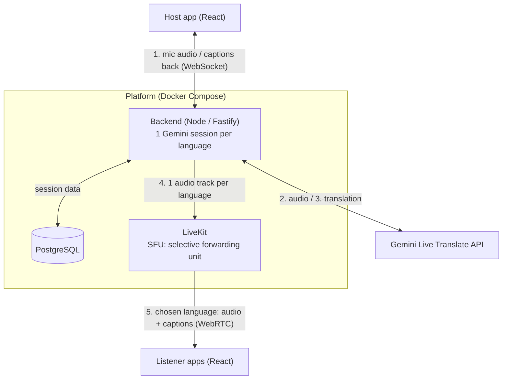
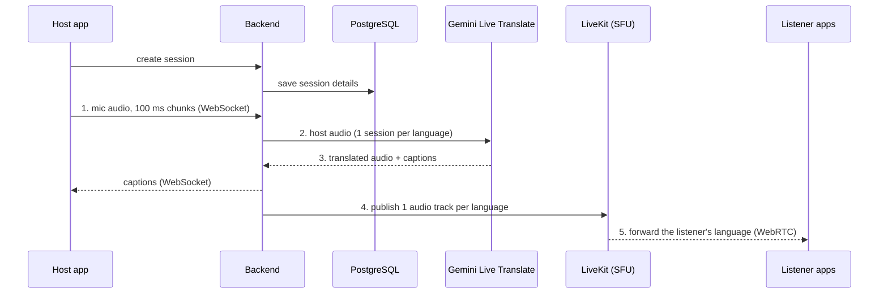
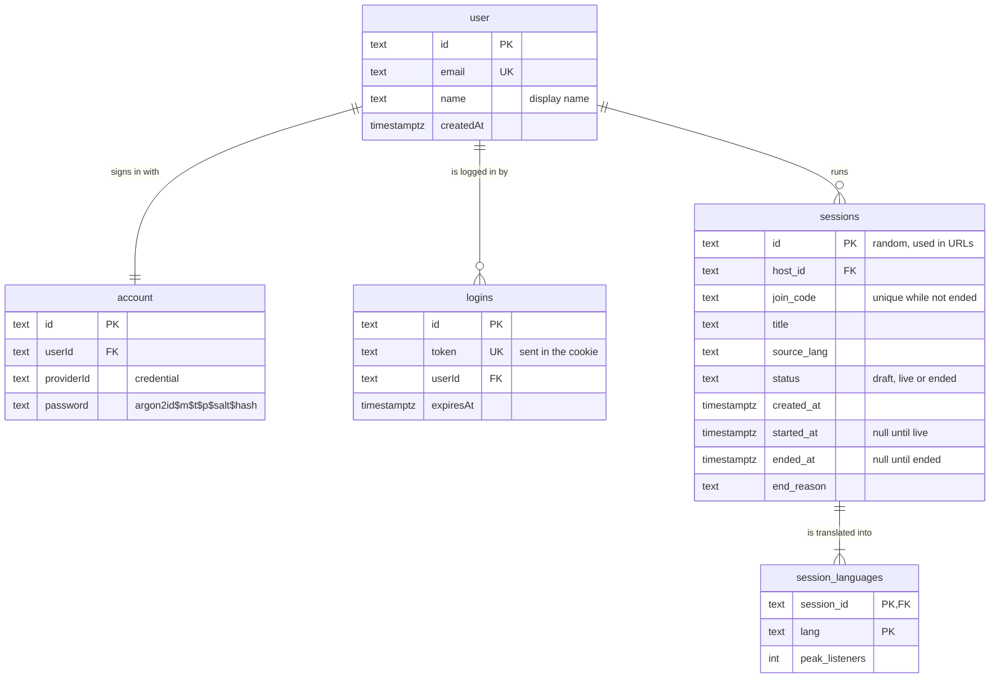

# Architecture

This is the **target architecture for the final prototype**. The choice of LiveKit
and PostgreSQL is being recorded in the [decision records](adr/index.md).

## Overview

The host speaks once; every listener hears them in their chosen language.
The backend holds **one Gemini session per target language** and publishes one
audio track per language to LiveKit, which forwards each listener only the
language they picked. Cost grows with the number of languages, not listeners.

## Step by step

An **SFU (selective forwarding unit)** receives each audio track once and forwards
it to every listener who subscribed to it, without decoding or mixing. Listeners
connect to it over **WebRTC**, which is built for real-time media.

## Data model

PostgreSQL stores host accounts, logins, sessions and their target languages. The
reasons are in [ADR-0002](adr/0002-session-and-account-storage.md) (storage) and
[ADR-0003](adr/0003-host-authentication.md) (host logins). Host accounts and logins use the tables Better Auth
creates (`user`, `account`, and its `session` table, renamed to `logins`); only
their main fields are shown. Better Auth also creates `verification` and, because
rate limits are kept in the database, `rateLimit`; neither is drawn here.

- **user:** one row per host account.
- **account:** how a host signs in. For email and password, it holds the
  password, stored only as an Argon2id hash.
- **logins:** one row per logged-in browser. Better Auth calls this table
  `session`; it is renamed so "session" always means a live event. Rows expire
  after 12 hours.
- **sessions:** one row per live event, owned by a host. `join_code` only has to
  be unique among sessions that haven't ended, so short codes can be reused.
- **session_languages:** each target language of a session, listed once, with its
  peak listener count to show where the Gemini cost goes.
- Deleting a live event deletes its languages; deleting a host deletes their
  logins. Ended events are deleted after 30 days, and expired logins daily.
- **Not stored:** audio, captions or transcripts, listener identities, and live
  state such as connections.
