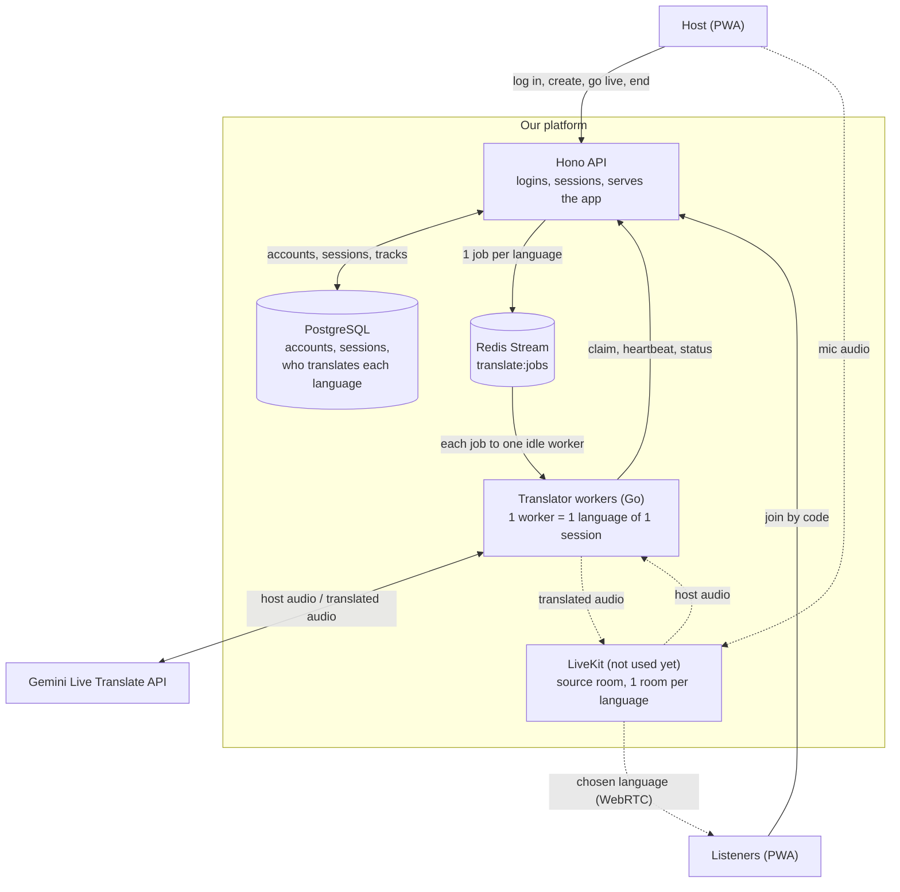
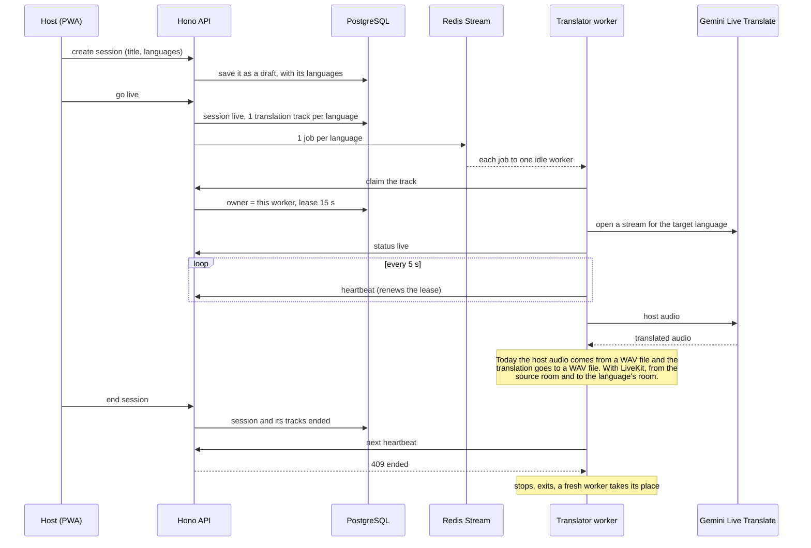
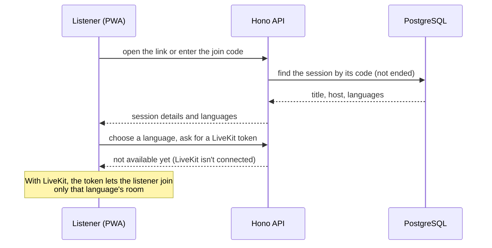
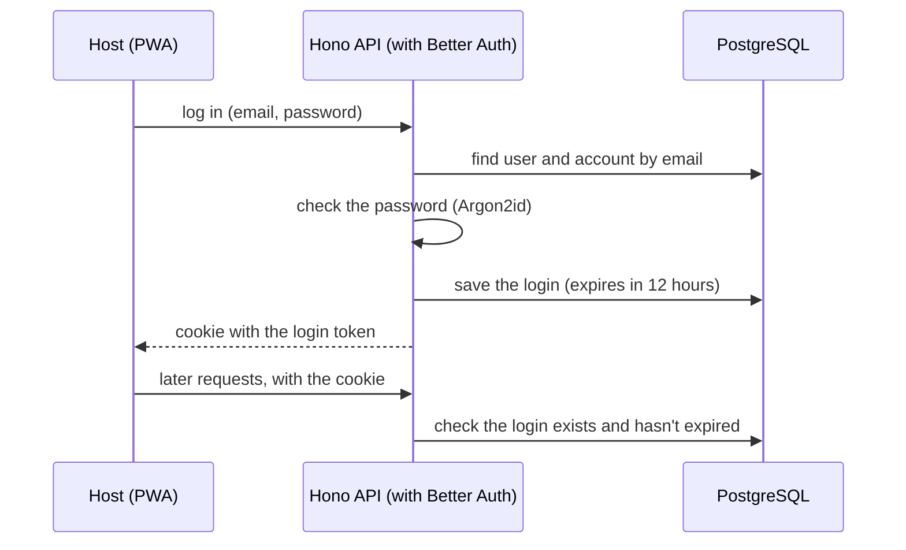
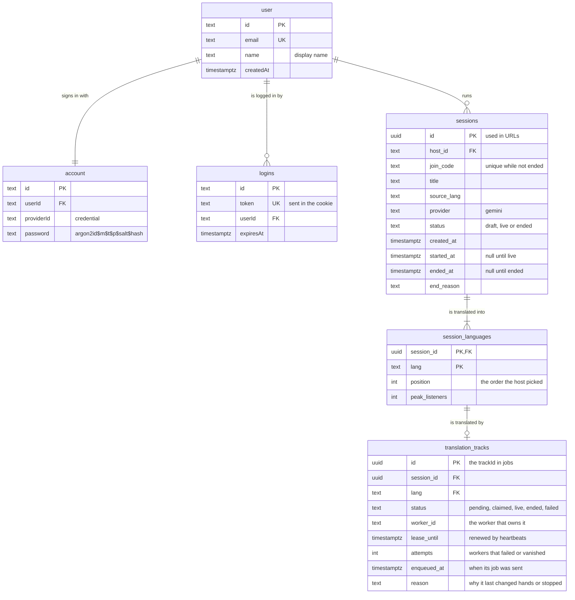

# Architecture

How the parts of AI Dubbing Studio fit together. The reasons for each choice are
in the [decision records](adr/index.md); a closer look at each part, with the
detailed flows, is in [Architecture layers](architecture-layers.md).

## Overview

The host speaks once; every listener hears them in their chosen language.

- The **Hono API** handles host logins and sessions, stores them in
  PostgreSQL, and serves the app. When a session goes live, it hands each
  target language to a translator worker.
- The **translator workers** are a pool of small Go processes. Each one
  translates **one target language of one session** with Gemini Live
  Translate, then exits, and a fresh one takes its place. Idle workers wait for
  work on a **Redis Stream**.
- **PostgreSQL** records which worker owns each language's translation.
  **Redis** only delivers the jobs.
- **LiveKit** will carry the audio: the host publishes once to a source room,
  each worker publishes its language to that language's room, and each
  listener joins only the room of the language they picked.

Cost grows with the number of languages, not listeners.

## What is built

| Part | Status |
|---|---|
| The app (React PWA): register, log in, Studio, join, listener pages | Built. Listening needs LiveKit. |
| API: host logins, sessions (create, go live, end), joining by code | Built |
| API: translation tracks, the Redis job stream, the workers' internal API, the sweeper that recovers tracks | Built |
| Translator workers (Go) with Gemini Live Translate | Built. Until LiveKit is connected, a worker reads the host's audio from a WAV file and writes the translation to another one. |
| LiveKit server | Runs in Docker Compose (`config/livekit.yaml`), but nothing uses it yet |
| LiveKit in the app, the API and the workers: the host's audio in, translated audio out, listener tokens | Not built |
| Captions | Not built |

Dotted lines are the LiveKit parts that aren't built yet: the LiveKit server
runs in Docker Compose, but nothing connects to it so far.

## Step by step

A session from creation to its end. The [layers page](architecture-layers.md)
shows each part of it in more detail, and what happens when a worker fails.

Measured in Docker Compose with the real Gemini API: each language was claimed
28 ms after **Go live** and live within half a second, translated speech came
about 3 seconds after the first words, and after **End session** every worker
stopped at its next heartbeat (within 5 seconds).

An **SFU (selective forwarding unit)** such as LiveKit receives each audio track
once and forwards it to every listener who subscribed to it, without decoding or
mixing. Listeners connect to it over **WebRTC**, which is built for real-time
media.

### A listener joins

Listeners have no account. They only need the join code.

### A host logs in

The details are in [ADR-0003](adr/0003-host-authentication.md).

## Why it's built this way

| Part | Decision |
|---|---|
| LiveKit for listener audio | [ADR-0001](adr/0001-audio-fan-out.md) |
| PostgreSQL | [ADR-0002](adr/0002-session-and-account-storage.md) |
| Host logins | [ADR-0003](adr/0003-host-authentication.md) |
| Hono for the API | [ADR-0007](adr/0007-backend-framework.md) |
| Translation runs apart from the API | [ADR-0008](adr/0008-separated-container.md) |
| The translation provider is chosen per session | [ADR-0009](adr/0009-translation-engine-communication.md) |
| One React PWA | [ADR-0010](adr/0010-mobile-native.md) |
| Audio on phones | [ADR-0011](adr/0011-audio-handling.md) |
| Hono serves the app | [ADR-0012](adr/0012-serving-pwa-bundle.md) |
| LiveKit client in the app | [ADR-0013](adr/0013-sfu-client.md) |
| The app's pages | [ADR-0014](adr/0014-pages.md) |
| Better Auth for host logins | [ADR-0015](adr/0015-auth-library.md) |
| Schemas and validation | [ADR-0016](adr/0016-schema-validator.md) |
| Jobs through a Redis Stream to single-use workers, owners in Postgres | [ADR-0018](adr/0018-autoscaling-architecture-of-translation-container.md) |
| The translator worker in Go, with an OpenAPI contract to the API | [ADR-0019](adr/0019-translation-worker-runtime.md) |
| Host audio through a LiveKit source room, one room per language | [ADR-0020](adr/0020-input-audio-stream.md) |

## Data model

PostgreSQL stores host accounts, logins, sessions, their target languages, and
who translates each language. The reasons are in
[ADR-0002](adr/0002-session-and-account-storage.md) (storage),
[ADR-0003](adr/0003-host-authentication.md) (host logins) and
[ADR-0018](adr/0018-autoscaling-architecture-of-translation-container.md)
(translation tracks). Host accounts and logins use the tables Better Auth creates
(`user`, `account`, and its `session` table, renamed to `logins`); only their
main fields are shown. Better Auth also creates `verification` and, because rate
limits are kept in the database, `rateLimit`; neither is drawn here.

- **user:** one row per host account.
- **account:** how a host signs in. For email and password, it holds the
  password, stored only as an Argon2id hash.
- **logins:** one row per logged-in browser. Better Auth calls this table
  `session`; it is renamed so "session" always means a live event. Rows expire
  after 12 hours.
- **sessions:** one row per live event, owned by a host. `join_code` only has to
  be unique among sessions that haven't ended, so short codes can be reused.
- **session_languages:** each target language of a session, in the order the
  host picked them, with its peak listener count to show where the Gemini cost
  goes. LiveKit rooms aren't stored: their names are made from the session and
  the language ([ADR-0020](adr/0020-input-audio-stream.md)).
- **translation_tracks:** one per language once the session goes live: its
  status, the worker that owns it and that worker's lease. A worker renews the
  lease every 5 seconds; when a lease runs out, the track goes to another
  worker. After 3 workers failed or vanished on it, it is `failed`.
- Deleting a session deletes its languages and tracks; deleting a host deletes
  their logins and sessions.
- Our tables are created by numbered SQL files in `apps/api/migrations`, each
  applied once and recorded in `schema_migrations`.
- Redis holds only the job messages, never the owner of a track.
- **Not stored in the database:** audio, captions or transcripts, listener
  identities, and live state such as connections. Until LiveKit is connected,
  the workers write the translated audio to WAV files, for development.
