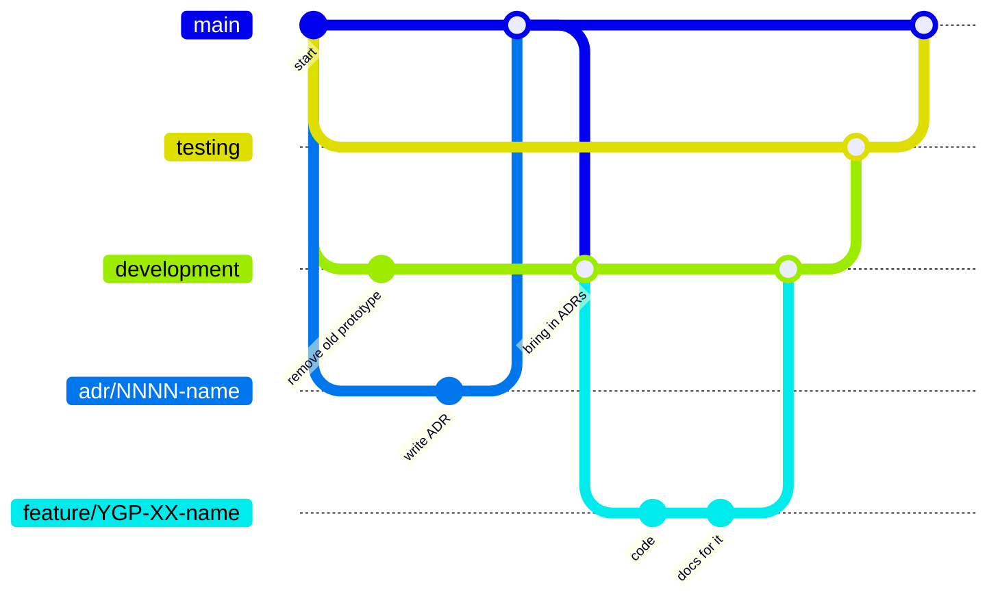

# Branching strategy

This is how we use Git branches from Sprint 2 onwards, while the prototype is
rebuilt from scratch. New code is put together on `development`, checked on
`testing` and released on `main`. Decisions (ADRs) skip that path and go straight
to `main`.

## The branches

| Branch | Created from | Merges into | What it's for |
|---|---|---|---|
| `main` | — | — | Production. The [docs site](index.md) is published from here. |
| `adr/NNNN-name` | `main` | `main` | One decision record, or a docs-only fix. |
| `development` | `main` (once) | `testing` | Where finished features are put together. |
| `feature/YGP-XX-name` | `development` | `development` | One Jira task or subtask, with its code and docs. |
| `fix/YGP-XX-name` | `development` | `development` | A bug found on `testing`. |
| `testing` | `main` (once) | `main` | Checking a feature before it is released. |

`YGP-XX` is the Jira key, so the branch shows up in that task's **Development**
panel in Jira.

## Rules

1. **Release one feature at a time.** When a feature is ready, it goes
   `development` → `testing` → `main`. We don't wait for the end of the sprint.
2. **Docs travel with the code.** Write a feature's docs on its feature branch.
   They go live when the feature reaches `main`. ADRs are branched from `main`
   and merged straight back, as described in [Writing the docs](writing-docs.md).
3. **Fix bugs on `development` first.** If something breaks on `testing`, fix it
   on a `fix/` branch from `development`, then send it through `testing` again
   before it reaches `main`.
4. **Keep `development` up to date.** After an ADR is merged into `main`, merge
   `main` into `development` so the docs on both branches don't drift apart.
5. **Every merge is a pull request.** A teammate reviews it and the checks must
   pass first.

## Still to be decided

- Whether `testing` is only a branch or also a deployed test environment (for
  example the K3s VM in YGP-53).
- How we deploy. The plan is Kubernetes (K3s) with Argo CD, with Docker
  Compose as the backup if there isn't time. An ADR will confirm this.
