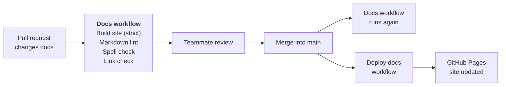

# CI/CD

GitHub Actions checks the docs and the translator code, and publishes the docs
site. Three workflows do the work:

- **Docs** (`.github/workflows/docs.yml`) checks the docs on every pull request
  that changes them, and again after each merge into `main`.
- **Deploy docs** (`.github/workflows/deploy-docs.yml`) builds the site and
  publishes it to [GitHub Pages](https://wh1te-shad0w.github.io/ai-dubbing-studio/)
  whenever the docs change on `main`.
- **Translator** (`.github/workflows/translator.yml`) checks the translator
  worker, its contract with the API, and the API, on every pull request that
  changes them. See [Translator workflow](#translator-workflow).

The app (`apps/web`) has no pipeline yet; see
[Code CI (planned)](#code-ci-planned).

## How a docs change goes live



The four checks run at the same time, as separate jobs. Each one can fail the
pull request on its own, so the log shows straight away which kind of problem
it is.

## Docs checks

The **Docs** workflow runs when a pull request, or a push to `main`, changes
any of these files:

- anything in `docs/`
- `mkdocs.yml`
- `README.md`
- `requirements-docs.txt`
- `.github/workflows/docs.yml`

A pull request that only changes code doesn't run it.

| Job | Tool and version | Settings | Fails when |
|---|---|---|---|
| Build site (strict) | MkDocs 1.6.1 with Material 9.8.0 (`requirements-docs.txt`), on Python 3.12 | `mkdocs.yml` | MkDocs gives any warning, for example a link to a page that doesn't exist or a nav entry for a missing file. `--strict` turns warnings into failures. |
| Markdown lint | markdownlint-cli2 0.18.1 | `.markdownlint-cli2.yaml` | A Markdown file in `docs/` or `README.md` breaks a lint rule, for example a missing blank line around a heading or a file that doesn't end in a newline. |
| Spell check | codespell 2.4.1 | none | A word in `docs/`, `README.md` or `mkdocs.yml` is on codespell's list of common misspellings. It only flags known mistakes, so technical terms don't need a word list. |
| Link check | lychee, through `lycheeverse/lychee-action@v2` | arguments in `docs.yml` | A link to another website is broken. Links to `localhost` are skipped, because they point at a developer's own machine. |

Two lint rules are changed from their defaults in `.markdownlint-cli2.yaml`:

- **Line length (MD013) is off.** Tables, links and long sentences go past 80
  characters, and wrapping them would make them harder to edit.
- **Nested lists are indented by 4 spaces (MD007).** MkDocs needs 4 spaces to
  show a nested list correctly.

GitGuardian also scans every pull request for leaked secrets such as API keys.
It is a GitHub app connected to the repository, not a workflow in this
repository, so it shows on the pull request as a separate check.

The versions are pinned so a new release of a tool can't suddenly fail a pull
request that passed the day before. The link-check action is pinned to its
major version (`v2`) only.

## Publishing the site

The **Deploy docs** workflow publishes the site to
<https://wh1te-shad0w.github.io/ai-dubbing-studio/>. It runs:

- after a push to `main` that changes anything in `docs/`, `mkdocs.yml`,
  `requirements-docs.txt` or `.github/workflows/deploy-docs.yml`. In practice
  that is the merge of a pull request. `README.md` isn't part of the site, so
  changing it doesn't redeploy.
- by hand, from **Actions → Deploy docs → Run workflow** on GitHub.

It has two jobs, one after the other:

| Job | What it does |
|---|---|
| Build site | Installs MkDocs from `requirements-docs.txt` (the same versions as local builds), runs `mkdocs build --strict` and uploads the built `site/` folder. |
| Deploy to GitHub Pages | Starts only if the build passed. Publishes the uploaded site and shows its address on the run page. |

A few settings keep it safe:

- **Only the permissions it needs.** It can read the repository, write to
  Pages, and prove to Pages that the upload came from this workflow
  (`id-token: write`). It can't push code or change anything else.
- **One deploy at a time.** If two merges land close together, the second
  deploy waits for the first to finish instead of cancelling it, so a
  half-finished deploy never replaces the live site.

The two workflows are separate. Deploy docs repeats the strict build, so a
broken page never goes live, but it doesn't wait for the lint, spelling and
link checks. If one of those fails after a merge, the site still updates, and
the failure shows as a red check on `main` to fix in a follow-up pull request.

## Running the checks locally

Run the same checks before you push, so a pull request doesn't fail on
something you could have caught. The commands are in
[Writing the docs](writing-docs.md#run-the-checks-locally).

What a pass looks like:

| Check | A pass looks like |
|---|---|
| Strict build | The last line is `Documentation built in … seconds`, with no `WARNING` above it. |
| Markdown lint | `Summary: 0 error(s)`. |
| Spell check | No output at all. |

Two messages from the build look like problems but aren't:

- **A list of pages "not included in the nav".** The ADRs are reached from the
  ADR index instead of the nav. This is information only and doesn't fail the
  build.
- **A notice that Material for MkDocs reaches end of life in May 2027.** It
  comes from the theme, not from our docs, and doesn't fail the build.

If `mkdocs` or `codespell` isn't found, Python's scripts folder isn't on your
PATH. Run them through Python instead: `python -m mkdocs build --strict` and
`python -m codespell_lib docs README.md mkdocs.yml`.

The link check runs only in CI, so it isn't installed locally.

## When a check fails

To find the error:

1. On the pull request, open the **Checks** tab, or select **Details** next
   to the red check.
2. Select the failed job, then expand the step with the red cross.
3. The error line names the file, the line and the problem.

| Job | What the error looks like | How to fix it |
|---|---|---|
| Build site (strict) | A `WARNING` line, for example a link whose target isn't found, then `Aborted with 1 warnings in strict mode!` | Correct the link's path, or add the missing page or nav entry. |
| Markdown lint | `file.md:12 MD022/blanks-around-headings …`: the file, the line and the rule | Fix the formatting on that line. Each rule is explained in the [markdownlint rules](https://github.com/DavidAnson/markdownlint/blob/main/doc/Rules.md). |
| Spell check | `file.md:12: <misspelling> ==> <suggestion>` | Fix the spelling. If the word is correct, ask the team before adding it to an ignore list. |
| Link check | The broken URL and why it failed, for example `404` or a timeout | Update or remove the link. If the other site is only down for a while, re-run the job. |

Push the fix to the same branch and the checks run again by themselves.

If a check fails on `main` after a merge, fix it in a small follow-up pull
request on a `docs/` branch. For example, ADR-0017 was merged with lint errors,
and [pull request #20](https://github.com/WH1TE-SHAD0W/ai-dubbing-studio/pull/20)
fixed them.

## Translator workflow

The **Translator** workflow (`.github/workflows/translator.yml`) runs on every
pull request that changes any of these, and again after a push to `main` or
`development` that does:

- anything in `apps/translator/`, `apps/api/` or `packages/contracts/`
- `pnpm-lock.yaml`
- `.github/workflows/translator.yml`

Its three jobs run at the same time:

| Job | What it runs | Fails when |
|---|---|---|
| Format, vet, generate, test | In `apps/translator`, with the Go version from `go.mod` and a Redis 8 service: `gofmt -l .`, `go vet ./...`, `go generate ./...` followed by `git diff --exit-code`, `go test -race ./...`, then `go test -race -tags integration ./...` against the Redis service. | A Go file isn't formatted, `go vet` finds a problem, the generated Go types no longer match the OpenAPI document, or a test fails, including a data race. |
| Contract types, API tests (Postgres, Redis) | With Node 24, pnpm through Corepack, and Postgres 18 and Redis 8 services: `pnpm install --frozen-lockfile`, `pnpm --filter @ads/contracts gen:openapi` followed by `git diff --exit-code -- packages/contracts/src/generated`, then typecheck and test `@ads/contracts` and `@ads/api`. | The lockfile doesn't match `package.json`, the TypeScript types no longer match the OpenAPI document, a Zod schema no longer matches its generated type, or a test fails. The API's database tests run against the Postgres service, in their own `dubbing_test` database. |
| Build image | `docker build` in `apps/translator`. | The worker's image doesn't build. |

The OpenAPI document `packages/contracts/openapi/translator-control.yaml` is the
one source for both sides' types, so the two "generated … up to date" steps
keep the Go worker and the API from drifting apart.

### Running these checks locally

From the repository root, with Postgres and Redis running
(`docker compose up -d postgres redis`) and `.env` loaded into the shell:

```bash
cd apps/translator
gofmt -l .                                   # must print nothing
go vet ./...
go test -race ./...
go test -race -tags integration ./...        # uses REDIS_URL
cd ../..
pnpm --filter @ads/contracts --filter @ads/api typecheck
pnpm --filter @ads/contracts --filter @ads/api test
```

[Testing](testing.md) explains each test, and the Redis integration tests.

### When a Translator check fails

| Step | How to fix it |
|---|---|
| gofmt | Run `gofmt -w .` in `apps/translator` and commit. |
| Generated code is up to date | You changed the OpenAPI document without regenerating, or edited a generated file. Run `go generate ./...` in `apps/translator` and commit `internal/control/api/types.gen.go`. |
| Generated contract types are up to date | Same for the TypeScript side: run `pnpm --filter @ads/contracts gen:openapi` and commit `packages/contracts/src/generated/`. |
| Typecheck | If it names `test/translator.test.ts`, a Zod schema in `packages/contracts/src/translator.ts` no longer matches the OpenAPI document; change one to match the other. |
| `pnpm install --frozen-lockfile` | Run `pnpm install` and commit `pnpm-lock.yaml`. |

## What's enforced today

The [branching strategy](branching-strategy.md) says every merge is a pull
request, reviewed by a teammate, with all checks passing. Today that is a team
agreement, not something GitHub enforces:

- The repository has a ruleset called **Main**, but it doesn't target any
  branches yet, so it has no effect.
- Even once it targets `main`, its two rules only stop the branch being deleted
  or force-pushed. It doesn't require a review or passing checks.
- So a red check or a missing review warns, but doesn't block the merge
  button.

Branch protection is planned in YGP-76: `main` and `testing` will need a pull
request, one approval and passing checks before a merge. One thing to solve
first: the Docs checks only run when docs change, so if they become required,
a pull request that only changes code would wait for them forever.

## Code CI (planned)

None of this is built yet. It is planned in Jira. The code monorepo (`apps/`,
`pnpm-workspace.yaml`) is now on `development`, so only the workflows are
missing.

| Workflow | Jira | Runs on | What it does |
|---|---|---|---|
| Code checks | YGP-75 | Every pull request into `development`, `testing` or `main` | Installs with pnpm (cached), then runs lint, typecheck and the Vitest tests across the monorepo. Needs a Postgres service: without `DATABASE_URL`, the API tests that use the database are skipped and the run still passes. Shows pass or fail on the pull request. |
| Image build and push | YGP-52 | Every merge into `testing` or `main` | Builds the Hono API and translation worker images and pushes them to GitHub's container registry (GHCR). If a build fails, nothing is pushed. |

The Go worker's checks already run in the
[Translator workflow](#translator-workflow).

### Image tags

Every image gets more than one tag:

| Tag | Given to | Used for |
|---|---|---|
| The commit SHA, for example `a7fa5e4…` | Every image | Finding exactly which code an image was built from, and rolling back to it. |
| `testing` | Images built from `testing` | The test environment. |
| `prod` | Images built from `main` | Production. |

The test environment only ever runs the `testing` tag and production only runs
`prod` (YGP-81), so a test deployment never picks up an image that hasn't been
through `testing`, and production never picks up one that hasn't reached
`main`.
