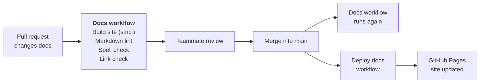

# CI/CD

The docs are checked and published by GitHub Actions. Two workflows do the
work:

- **Docs** (`.github/workflows/docs.yml`) checks the docs on every pull request
  that changes them, and again after each merge into `main`.
- **Deploy docs** (`.github/workflows/deploy-docs.yml`) builds the site and
  publishes it to [GitHub Pages](https://wh1te-shad0w.github.io/ai-dubbing-studio/)
  whenever the docs change on `main`.

## How a docs change goes live

The four checks run at the same time, as separate jobs. Each one can fail the
pull request on its own, so the log shows straight away which kind of problem
it is.

## Docs checks

The **Docs** workflow runs when a pull request, or a push to `main`, changes
any of these files:

- anything in `docs/`
- `mkdocs.yml`
- `README.md`
- `requirements-docs.txt`
- `.github/workflows/docs.yml`

A pull request that only changes code doesn't run it.

| Job | Tool and version | Settings | Fails when |
|---|---|---|---|
| Build site (strict) | MkDocs 1.6.1 with Material 9.8.0 (`requirements-docs.txt`), on Python 3.12 | `mkdocs.yml` | MkDocs gives any warning, for example a link to a page that doesn't exist or a nav entry for a missing file. `--strict` turns warnings into failures. |
| Markdown lint | markdownlint-cli2 0.18.1 | `.markdownlint-cli2.yaml` | A Markdown file in `docs/` or `README.md` breaks a lint rule, for example a missing blank line around a heading or a file that doesn't end in a newline. |
| Spell check | codespell 2.4.1 | none | A word in `docs/`, `README.md` or `mkdocs.yml` is on codespell's list of common misspellings. It only flags known mistakes, so technical terms don't need a word list. |
| Link check | lychee, through `lycheeverse/lychee-action@v2` | arguments in `docs.yml` | A link to another website is broken. Links to `localhost` are skipped, because they point at a developer's own machine. |

Two lint rules are changed from their defaults in `.markdownlint-cli2.yaml`:

- **Line length (MD013) is off.** Tables, links and long sentences go past 80
  characters, and wrapping them would make them harder to edit.
- **Nested lists are indented by 4 spaces (MD007).** MkDocs needs 4 spaces to
  show a nested list correctly.

The versions are pinned so a new release of a tool can't suddenly fail a pull
request that passed the day before. The link-check action is pinned to its
major version (`v2`) only.
