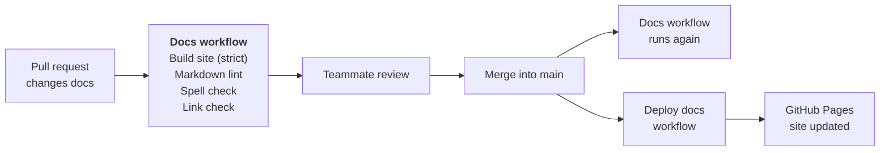

# CI/CD

The docs are checked and published by GitHub Actions. Two workflows do the
work:

- **Docs** (`.github/workflows/docs.yml`) checks the docs on every pull request
  that changes them, and again after each merge into `main`.
- **Deploy docs** (`.github/workflows/deploy-docs.yml`) builds the site and
  publishes it to [GitHub Pages](https://wh1te-shad0w.github.io/ai-dubbing-studio/)
  whenever the docs change on `main`.

## How a docs change goes live

The four checks run at the same time, as separate jobs. Each one can fail the
pull request on its own, so the log shows straight away which kind of problem
it is.
