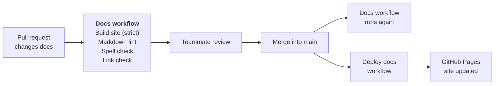

# CI/CD

The docs are checked and published by GitHub Actions. Two workflows do the
work:

- **Docs** (`.github/workflows/docs.yml`) checks the docs on every pull request
  that changes them, and again after each merge into `main`.
- **Deploy docs** (`.github/workflows/deploy-docs.yml`) builds the site and
  publishes it to [GitHub Pages](https://wh1te-shad0w.github.io/ai-dubbing-studio/)
  whenever the docs change on `main`.

## How a docs change goes live

The four checks run at the same time, as separate jobs. Each one can fail the
pull request on its own, so the log shows straight away which kind of problem
it is.

## Docs checks

The **Docs** workflow runs when a pull request, or a push to `main`, changes
any of these files:

- anything in `docs/`
- `mkdocs.yml`
- `README.md`
- `requirements-docs.txt`
- `.github/workflows/docs.yml`

A pull request that only changes code doesn't run it.

| Job | Tool and version | Settings | Fails when |
|---|---|---|---|
| Build site (strict) | MkDocs 1.6.1 with Material 9.8.0 (`requirements-docs.txt`), on Python 3.12 | `mkdocs.yml` | MkDocs gives any warning, for example a link to a page that doesn't exist or a nav entry for a missing file. `--strict` turns warnings into failures. |
| Markdown lint | markdownlint-cli2 0.18.1 | `.markdownlint-cli2.yaml` | A Markdown file in `docs/` or `README.md` breaks a lint rule, for example a missing blank line around a heading or a file that doesn't end in a newline. |
| Spell check | codespell 2.4.1 | none | A word in `docs/`, `README.md` or `mkdocs.yml` is on codespell's list of common misspellings. It only flags known mistakes, so technical terms don't need a word list. |
| Link check | lychee, through `lycheeverse/lychee-action@v2` | arguments in `docs.yml` | A link to another website is broken. Links to `localhost` are skipped, because they point at a developer's own machine. |

Two lint rules are changed from their defaults in `.markdownlint-cli2.yaml`:

- **Line length (MD013) is off.** Tables, links and long sentences go past 80
  characters, and wrapping them would make them harder to edit.
- **Nested lists are indented by 4 spaces (MD007).** MkDocs needs 4 spaces to
  show a nested list correctly.

GitGuardian also scans every pull request for leaked secrets such as API keys.
It is a GitHub app connected to the repository, not a workflow in this
repository, so it shows on the pull request as a separate check.

The versions are pinned so a new release of a tool can't suddenly fail a pull
request that passed the day before. The link-check action is pinned to its
major version (`v2`) only.

## Publishing the site

The **Deploy docs** workflow publishes the site to
<https://wh1te-shad0w.github.io/ai-dubbing-studio/>. It runs:

- after a push to `main` that changes anything in `docs/`, `mkdocs.yml`,
  `requirements-docs.txt` or `.github/workflows/deploy-docs.yml`. In practice
  that is the merge of a pull request. `README.md` isn't part of the site, so
  changing it doesn't redeploy.
- by hand, from **Actions → Deploy docs → Run workflow** on GitHub.

It has two jobs, one after the other:

| Job | What it does |
|---|---|
| Build site | Installs MkDocs from `requirements-docs.txt` (the same versions as local builds), runs `mkdocs build --strict` and uploads the built `site/` folder. |
| Deploy to GitHub Pages | Starts only if the build passed. Publishes the uploaded site and shows its address on the run page. |

A few settings keep it safe:

- **Only the permissions it needs.** It can read the repository, write to
  Pages, and prove to Pages that the upload came from this workflow
  (`id-token: write`). It can't push code or change anything else.
- **One deploy at a time.** If two merges land close together, the second
  deploy waits for the first to finish instead of cancelling it, so a
  half-finished deploy never replaces the live site.

The two workflows are separate. Deploy docs repeats the strict build, so a
broken page never goes live, but it doesn't wait for the lint, spelling and
link checks. If one of those fails after a merge, the site still updates, and
the failure shows as a red check on `main` to fix in a follow-up pull request.

## Running the checks locally

Run the same checks before you push, so a pull request doesn't fail on
something you could have caught. The commands are in
[Writing the docs](writing-docs.md#run-the-checks-locally).

What a pass looks like:

| Check | A pass looks like |
|---|---|
| Strict build | The last line is `Documentation built in … seconds`, with no `WARNING` above it. |
| Markdown lint | `Summary: 0 error(s)`. |
| Spell check | No output at all. |

Two messages from the build look like problems but aren't:

- **A list of pages "not included in the nav".** The ADRs are reached from the
  ADR index instead of the nav. This is information only and doesn't fail the
  build.
- **A notice that Material for MkDocs reaches end of life in May 2027.** It
  comes from the theme, not from our docs, and doesn't fail the build.

If `mkdocs` or `codespell` isn't found, Python's scripts folder isn't on your
PATH. Run them through Python instead: `python -m mkdocs build --strict` and
`python -m codespell_lib docs README.md mkdocs.yml`.

The link check runs only in CI, so it isn't installed locally.

## When a check fails

To find the error:

1. On the pull request, open the **Checks** tab, or select **Details** next
   to the red check.
2. Select the failed job, then expand the step with the red cross.
3. The error line names the file, the line and the problem.

| Job | What the error looks like | How to fix it |
|---|---|---|
| Build site (strict) | A `WARNING` line, for example a link whose target isn't found, then `Aborted with 1 warnings in strict mode!` | Correct the link's path, or add the missing page or nav entry. |
| Markdown lint | `file.md:12 MD022/blanks-around-headings …`: the file, the line and the rule | Fix the formatting on that line. Each rule is explained in the [markdownlint rules](https://github.com/DavidAnson/markdownlint/blob/main/doc/Rules.md). |
| Spell check | `file.md:12: <misspelling> ==> <suggestion>` | Fix the spelling. If the word is correct, ask the team before adding it to an ignore list. |
| Link check | The broken URL and why it failed, for example `404` or a timeout | Update or remove the link. If the other site is only down for a while, re-run the job. |

Push the fix to the same branch and the checks run again by themselves.

If a check fails on `main` after a merge, fix it in a small follow-up pull
request on a `docs/` branch. For example, ADR-0017 was merged with lint errors,
and [pull request #20](https://github.com/WH1TE-SHAD0W/ai-dubbing-studio/pull/20)
fixed them.
