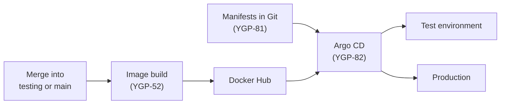

# Deployment

How the app is deployed, updated and rolled back. Some of it is built and some
is still planned, so each part says which:

- **Built** means the code is on `development`. It reaches `main`, and this
  site, when the feature is released (see the
  [branching strategy](branching-strategy.md)).
- **Planned** means it is in Jira but not built yet.

## Where it runs

| | Where | Status |
|---|---|---|
| **Today** | Docker Compose, on a developer's machine or a single server | Built |
| **Target** | A K3s (lightweight Kubernetes) cluster on a VM (YGP-53, YGP-87), kept up to date by Argo CD (YGP-82) | Planned |
| **Backup** | Docker Compose on the same VM, if the K3s setup isn't ready in time (YGP-84) | Planned |

Settings are in `.env`; see the [Setup Guide](setup-guide.md#settings-env).

## Components

| Component | Status | What it does | Decision |
|---|---|---|---|
| `postgres` | Built | Host accounts and logins, on the `postgres-data` volume | [ADR-0002](adr/0002-session-and-account-storage.md) |
| `api` | Built | The Hono API: serves the built app and handles host logins with Better Auth | [ADR-0012](adr/0012-serving-pwa-bundle.md), [ADR-0015](adr/0015-auth-library.md) |
| LiveKit | Planned | Carries the host's audio into a source room, and each language's translation out to listeners | [ADR-0001](adr/0001-audio-fan-out.md), [ADR-0013](adr/0013-sfu-client.md), ADR-0020 (proposed) |
| Redis | Planned | Hands translation jobs to worker pods through a Redis Stream | [ADR-0018](adr/0018-autoscaling-architecture-of-translation-container.md) (proposed) |
| Translation workers | Planned | A pool of pods, each serving one track (one language of one session) through Gemini | ADR-0018, ADR-0019 (proposed) |

The proposed decision records are listed in the [ADR index](adr/index.md).

### The built containers

| Container | Built from | Port |
|---|---|---|
| `postgres` | `postgres:18-alpine` | 5432, published on `127.0.0.1` only |
| `api` | `apps/api/Dockerfile` (Node 24 Alpine) | 3000 inside, `API_PORT` (default 3000) on `127.0.0.1` |

- The API starts once Postgres is healthy, and creates or updates its tables
  before it accepts requests.
- Both have a health check. The API's uses `GET /ready`, which also checks that
  Postgres answers; `GET /health` only checks that the process runs.
- Both restart automatically unless stopped by hand.
- The API runs as the non-root `node` user, and stops cleanly on `SIGTERM`: it
  finishes open requests and closes the database connections, within 8 seconds.

### The API image

`apps/api/Dockerfile` is built from the repository root, as it needs the whole
pnpm workspace:

```bash
docker build -f apps/api/Dockerfile -t ai-dubbing-studio-api .
```

It builds in two stages:

1. **Build**: installs the workspace with pnpm, builds the app (`apps/web/dist`)
   and bundles the API into one file with esbuild.
2. **Runtime**: Node 24 Alpine with just that file and the built app. No
   `node_modules`, pnpm or build tools, about 250 MB in all, most of it Node.

## How a release reaches the cluster (planned)

Git says what should run, and Argo CD makes the cluster match it. Nobody
deploys to the cluster by hand.



1. A merge into `testing` or `main` builds the images and pushes them to
   Docker Hub. Each image is tagged with its commit SHA, plus `testing` or
   `prod`. The [CI/CD page](ci-cd.md#code-ci-planned) covers the image build
   and its tags.
2. The Kubernetes manifests in Git (YGP-81) describe what each environment
   runs, including the autoscaling for the worker pool.
3. Argo CD (YGP-82) watches the manifests and syncs the cluster to them.

| Branch | Image tag | Environment |
|---|---|---|
| `testing` | `testing` | Test |
| `main` | `prod` | Production |

So a test deployment never runs an image that hasn't been through `testing`,
and production never runs one that hasn't reached `main`.

## Deploy or update with Docker Compose (built)

On the server, from the repository folder:

```bash
git pull
docker compose up --build -d
```

`-d` runs the containers in the background. To see the API's logs:

```bash
docker compose logs -f api
```

Before an update on a server, [back up the database](#back-up-the-database).

## Roll back

### With Docker Compose (built)

Compose builds the images from the code in the folder, so rolling back means
going back to an earlier commit and rebuilding:

```bash
git log --oneline              # find the last commit that worked
git checkout <commit>
docker compose up --build -d
```

Then [check the deploy](#check-a-deploy). When the fix is released, return to
the branch with `git switch main` and deploy again.

The database is not rolled back. The API only ever adds tables and columns, so
older code still runs against them. To undo data changes too, restore the
backup taken before the update.

### On K3s (planned)

1. Revert the bad change in Git (`git revert`) through a pull request, as for
   any other change.
2. Once it merges, a new image is built and Argo CD syncs the cluster back to
   the working version.

In an emergency, Argo CD can also roll an application back to an earlier sync
straight away. Git then has to be reverted as well, or Argo CD will sync the
bad version again. The rollback is tested as part of YGP-83.

## Check a deploy

After every deploy or rollback:

1. `docker compose ps` shows both containers as `healthy`.
2. The health endpoints answer:

    ```bash
    curl http://localhost:3000/health   # {"status":"ok"}: the API runs
    curl http://localhost:3000/ready    # {"status":"ok"}: it can reach Postgres
    ```

    `/ready` answers `503` with `database unavailable` if Postgres can't be
    reached.

3. The app opens in a browser and a host can log in.
4. `docker compose logs api` shows no errors since the start.

## Back up the database

The `postgres-data` volume holds every host account. To save a copy to a file:

```bash
docker compose exec postgres pg_dump -U dubbing dubbing > backup.sql
```

Use the `POSTGRES_USER` and `POSTGRES_DB` from `.env` if they differ.
`docker compose down -v` deletes the volume, so never use `-v` on a server.

## Things to know

- **HTTPS is not included.** The microphone only works in a secure context, so on
  a server put your own HTTPS reverse proxy (for example Caddy or nginx) in front
  of the `api` container. Then set `BETTER_AUTH_URL` to the https address, so the
  login cookie is `Secure`.
- **List any proxy in `TRUSTED_PROXIES`**, so rate limits see each client's real
  IP. Without it, every visitor seems to come from the proxy and they all share
  one limit of 5 logins a minute. On K3s this means the ingress (planned).
- **Both ports are published on `127.0.0.1` only**, so only that machine (and a
  reverse proxy on it) can reach them.
- **Secrets stay in `.env`**, which is git-ignored: the Postgres password and
  `BETTER_AUTH_SECRET`. Changing the secret logs every host out.
- **More than one API container works**, because logins and rate limits are
  kept in Postgres, not in memory. Start the first one alone on an empty
  database, though: each one creates the tables on start, and two doing it at
  once can clash.

## Still to be decided

- **How we deploy:** the decision record for K3s, Argo CD and the Compose
  backup (YGP-80).
- **How Argo CD picks up a new image:** the manifests could pin each image's
  commit SHA (CI commits the change), or follow the `testing` and `prod` tags.
- **The worker pool's size and limits** (ADR-0018 follow-up).
- **How secrets get into the cluster.**
- **HTTPS and the public address** for the VM (YGP-53).
