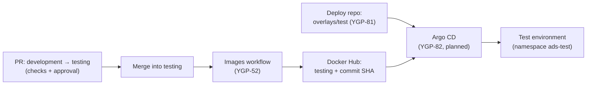

# Deployment and runbook

How the app is deployed, updated and rolled back. The operational runbook is
[Roll back](#roll-back), [Check a deploy](#check-a-deploy) and the
[Rollback drill](#rollback-drill). Some of it is built and some
is still planned, so each part says which:

- **Built** means the code is on `development`. It reaches `main`, and this
  site, when the feature is released (see the
  [branching strategy](branching-strategy.md)).
- **Planned** means it is in Jira but not built yet.

## Where it runs

| | Where | Status |
|---|---|---|
| **Today** | Docker Compose, on a developer's machine or a single server | Built |
| **Target** | A K3s (lightweight Kubernetes) cluster on a VM (YGP-53, YGP-87), kept up to date by Argo CD (YGP-82) | Planned |
| **Backup** | Docker Compose on the same VM, if the K3s setup isn't ready in time (YGP-84) | Planned |

Settings are in `.env`; see the [Setup Guide](setup-guide.md#settings-env).

## Components

| Component | Status | What it does | Decision |
|---|---|---|---|
| `postgres` | Built | Host accounts, logins, sessions and translation tracks, on the `postgres-data` volume | [ADR-0002](adr/0002-session-and-account-storage.md) |
| `api` | Built | The Hono API: serves the built app, host logins (Better Auth), sessions, translation tracks, and LiveKit rooms and tokens | [ADR-0012](adr/0012-serving-pwa-bundle.md), [ADR-0015](adr/0015-auth-library.md) |
| `redis` | Built | Hands translation jobs to the workers through a Redis Stream | [ADR-0018](adr/0018-autoscaling-architecture-of-translation-container.md) |
| `livekit` | Built, partly connected | Carries the host's audio into a source room, and each language's translation out to listeners. The host's mic and the listener page use it; the workers don't join it yet (YGP-70) | [ADR-0001](adr/0001-audio-fan-out.md), [ADR-0013](adr/0013-sfu-client.md), [ADR-0020](adr/0020-input-audio-stream.md) |
| `translator` | Built in Compose; on K3s planned | Go workers, each serving one track (one language of one session) through Gemini. Started only with the `translator` Compose profile | [ADR-0018](adr/0018-autoscaling-architecture-of-translation-container.md), [ADR-0019](adr/0019-translation-worker-runtime.md) |

The proposed decision records are listed in the [ADR index](adr/index.md).

### The containers in Compose

| Container | Built from | Port |
|---|---|---|
| `postgres` | `postgres:18-alpine` | 5432, published on `127.0.0.1` only |
| `api` | `apps/api/Dockerfile` (Node 24 Alpine) | 3000 inside, `API_PORT` (default 3000) on `127.0.0.1` |
| `redis` | `redis:8-alpine` | 6379, on `127.0.0.1` only |
| `livekit` | `livekit/livekit-server` | 7880 (HTTP and WebSocket), 7881 (TCP) and 7882/udp (media), on `LIVEKIT_BIND` (default `127.0.0.1`) |
| `translator` | `apps/translator/Dockerfile` (Go) | None: it only connects out, to Redis, the API and Gemini |

- The API starts once Postgres is healthy, and creates or updates its tables
  before it accepts requests.
- Every container has a health check. The API's uses `GET /ready`, which also checks that
  Postgres answers; `GET /health` only checks that the process runs.
- All of them restart automatically unless stopped by hand.
- The API runs as the non-root `node` user, and stops cleanly on `SIGTERM`: it
  finishes open requests and closes the database connections, within 8 seconds.

### The API image

`apps/api/Dockerfile` is built from the repository root, as it needs the whole
pnpm workspace:

```bash
docker build -f apps/api/Dockerfile -t ai-dubbing-studio-api .
```

It builds in two stages:

1. **Build**: installs the workspace with pnpm, builds the app (`apps/web/dist`)
   and bundles the API into one file with esbuild.
2. **Runtime**: Node 24 Alpine with just that file and the built app. No
   `node_modules`, pnpm or build tools, about 250 MB in all, most of it Node.

## How a release reaches the cluster

Git says what should run, and Argo CD makes the cluster match it. Nobody
deploys to the cluster by hand. The image half is built; the cluster half
waits on Argo CD (YGP-82).



### Step by step

| Step | Status | Where to see it |
|---|---|---|
| 1. Open a pull request from `development` into `testing`, listing what's being promoted. | Built | The pull request |
| 2. The checks run: [code checks](ci-cd.md#code-checks), [image build](ci-cd.md#image-build), the docs checks and the security scan (YGP-78). Another team member approves. | Built | The **Checks** tab of the pull request |
| 3. Merge. The Images workflow builds the API and worker images and pushes each to Docker Hub as `testing` and as the full commit SHA. | Built | **Actions → Images** for the merge commit, then the image's **Tags** page on Docker Hub |
| 4. Argo CD notices the new image and updates the `ads-test` namespace to it. | Planned | The test application shows **Synced** and **Healthy** in Argo CD |
| 5. [Check the deploy](#check-a-deploy). | Planned | See below |

Production works the same way, from `testing` into `main`, with the `prod`
tag and the `ads-prod` namespace.

| Branch | Image tag | Namespace |
|---|---|---|
| `testing` | `testing` | `ads-test` |
| `main` | `prod` | `ads-prod` |

So a test deployment never runs an image that hasn't been through `testing`,
and production never runs one that hasn't reached `main`.

### Where the manifests live

The Kubernetes manifests (YGP-81) describe what each environment runs. They
live in their own repository,
[ai-dubbing-studio-deploy](https://github.com/jamiemccourt800/ai-dubbing-studio-deploy):
a Kustomize `base` plus one overlay per environment (`overlays/test`,
`overlays/prod`), which sets the namespace, the image tag and the host name.
Its README covers the Secrets to create on the cluster and how to try it
locally.

The manifests are kept apart from the code, as Argo CD recommends. Changing
what runs never triggers this repository's CI, and the deploy repository's
history is a log of what ran when. Neither repository holds any secrets.

**Still open:** how Argo CD picks up a new image. With the moving `testing` tag
the manifests never change, so Argo CD needs Argo CD Image Updater or a restart
to notice it. The other way is for CI to write each commit SHA into the
overlay. [ADR-0021](adr/0021-how-we-deploy.md) records the choice once YGP-82
makes it. Rolling back works either way (below).

## Roll back

### With Docker Compose (built)

Compose builds the images from the code in the folder, so rolling back means
going back to an earlier commit and rebuilding:

```bash
git log --oneline              # find the last commit that worked
git checkout <commit>
docker compose up --build -d
```

Then [check the deploy](#check-a-deploy). When the fix is released, return to
the branch with `git switch main` and deploy again.

The database is not rolled back. The API only ever adds tables and columns, so
older code still runs against them. To undo data changes too, restore the
backup taken before the update.

### On K3s (planned)

Three ways back, from the normal one to the emergency one. Whichever you use,
[check the deploy](#check-a-deploy) afterwards and tell the team what was
rolled back and why.

**1. Revert in Git (the normal way).** Use it when there's time for a build
(a few minutes).

1. Find the merge that brought the bad change into `testing`:
   `git log --oneline --merges origin/testing`.
2. Revert it on a branch and open a pull request into `testing`:

    ```bash
    git switch -c revert/YGP-XX-what origin/testing
    git revert -m 1 <merge commit>
    git push -u origin revert/YGP-XX-what
    ```

3. Once it merges, new images are built from the reverted code and Argo CD
   syncs them, as for any release.

The fix then goes through `development` as usual.

**2. Pin a known-good image (exact and quick).** Use it to go back to one
earlier commit's images straight away, without a build.

1. Find the last good commit SHA: on Docker Hub (the image's **Tags** page),
   or with `git log --oneline origin/testing`. Every pushed image is tagged
   with its full SHA.
2. In the deploy repository, change the tag in
   `overlays/test/kustomization.yaml` from `testing` to that SHA, and open a
   pull request:

    ```yaml
    images:
      - name: ai-dubbing-studio-api
        newName: glossia/ai-dubbing-studio-api
        newTag: <full commit SHA>
    ```

3. Once it merges, Argo CD syncs the namespace to that exact image.
4. When the fix is released, set the tag back to `testing` the same way.

**3. Roll back in Argo CD (emergency only).** Use it when the app is down and
a pull request would take too long.

1. Turn off automatic sync for the application. Argo CD won't roll back while
   it's on, and would sync the bad version again anyway.
2. In the Argo CD UI, open the application, then **History and rollback**, and
   roll back to the last sync that worked. The CLI does the same:
   `argocd app rollback <application> <history ID>`.
3. Then do way 1 or 2 so Git matches the cluster, and turn automatic sync back
   on.

## Check a deploy

After every deploy or rollback.

### Compose check (built)

1. `docker compose ps` shows every container as `healthy`.
2. The health endpoints answer:

    ```bash
    curl http://localhost:3000/health   # {"status":"ok"}: the API runs
    curl http://localhost:3000/ready    # {"status":"ok"}: it can reach Postgres
    ```

    `/ready` answers `503` with `database unavailable` if Postgres can't be
    reached.

3. The app opens in a browser and a host can log in.
4. `docker compose logs api` shows no errors since the start.

### K3s check (planned)

```bash
kubectl -n ads-test rollout status deploy/api    # waits until the new pods are ready
kubectl -n ads-test get pods                     # every pod Running, READY 1/1
kubectl -n ads-test get deploy api -o jsonpath='{.spec.template.spec.containers[0].image}'
kubectl -n argocd get applications               # SYNC STATUS Synced, HEALTH Healthy
kubectl -n ads-test logs deploy/api --since=10m  # no errors since the update
```

1. The image shown is the one you meant: `testing` or the pinned SHA.
2. `/health` and `/ready` answer `{"status":"ok"}` at the test environment's
   address (the Ingress host in `overlays/test`).
3. The app opens in a browser and a host can log in.

A new pod only gets traffic once its readiness check (`/ready`) passes, so the
old pods keep serving until then.

## Rollback drill

YGP-83 asks for a rollback to be tried once on the test environment, so the
steps are known to work before they're needed.

**Status: not tried yet.** On 10 November the K3s cluster had six nodes ready,
but Argo CD (YGP-82) and the `ads-test` namespace weren't set up yet, so there
was nothing to roll back. This section is filled in once they are.

The drill:

1. Note the image the test environment runs now (the last good one).
2. Release a harmless visible change to `testing`, such as a version label.
3. Roll it back with way 2, pinning the last good SHA, and time it.
4. [Check the deploy](#check-a-deploy), and that the change is gone.
5. Set the tag back to `testing`.

| | Result |
|---|---|
| Date | Not tried yet |
| Change rolled back | |
| Way used | |
| Time from merge to healthy | |
| What we learned | |

## Back up the database

The `postgres-data` volume holds every host account. To save a copy to a file:

```bash
docker compose exec postgres pg_dump -U dubbing dubbing > backup.sql
```

Use the `POSTGRES_USER` and `POSTGRES_DB` from `.env` if they differ.
`docker compose down -v` deletes the volume, so never use `-v` on a server.

## Things to know

- **HTTPS is not included.** The microphone only works in a secure context, so on
  a server put your own HTTPS reverse proxy (for example Caddy or nginx) in front
  of the `api` container. Then set `BETTER_AUTH_URL` to the https address, so the
  login cookie is `Secure`.
- **List any proxy in `TRUSTED_PROXIES`**, so rate limits see each client's real
  IP. Without it, every visitor seems to come from the proxy and they all share
  one limit of 5 logins a minute. On K3s this means the ingress (planned).
- **Both ports are published on `127.0.0.1` only**, so only that machine (and a
  reverse proxy on it) can reach them.
- **Secrets stay in `.env`**, which is git-ignored: the Postgres password and
  `BETTER_AUTH_SECRET`. Changing the secret logs every host out.
- **Back up the `postgres-data` volume**: it holds every host account.
  `docker compose down -v` deletes it.
- **More than one API container works**: logins and rate limits are kept in
  Postgres, not in memory. Copies that start together don't clash over the
  tables either: the table updates run under one Postgres lock, so the second
  copy waits for the first (see
  [Database migrations](setup-guide.md#database-migrations)).

## Still to be decided

- **How we deploy:** the decision record for K3s, Argo CD and the Compose
  backup (YGP-80).
- **How Argo CD picks up a new image:** the manifests could pin each image's
  commit SHA (CI commits the change), or follow the `testing` and `prod` tags.
- **The worker pool's size and limits** (ADR-0018 follow-up).
- **How secrets get into the cluster.**
- **HTTPS and the public address** for the VM (YGP-53).
