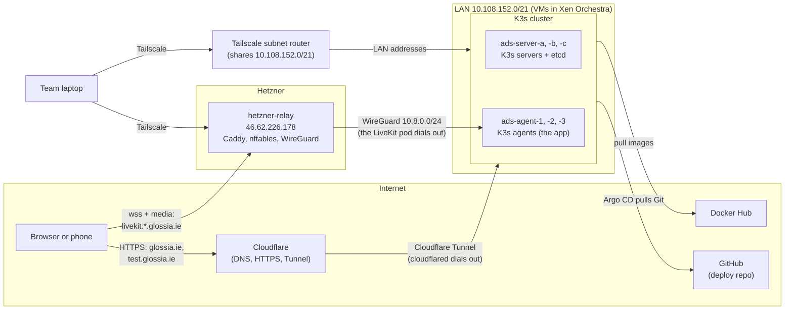
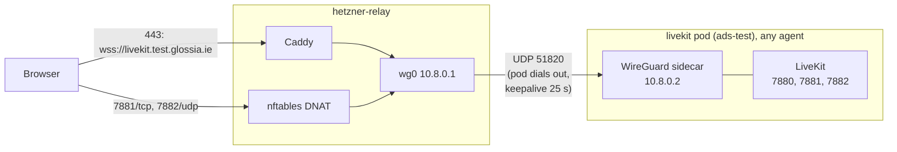

# Infrastructure

The machines, networks and links the app runs on: the VMs on the LAN, the
Hetzner relay, WireGuard, the firewalls, Cloudflare, and the K3s cluster with
its namespaces and Argo CD applications. How a release gets onto this, and how
to roll one back, is on [Deployment and runbook](deployment.md).

Everything here is built from the
[deploy repository](https://github.com/jamiemccourt800/ai-dubbing-studio-deploy):
the VMs with Ansible (`ansible/`), and everything on the cluster from its
manifests. No secrets are in either repository.

## The whole picture

Two rules shape all of it:

- **Nothing on the LAN is opened to the internet.** Every public path starts
  from inside and connects out: `cloudflared` to Cloudflare, the LiveKit pod's
  WireGuard sidecar to the relay, Argo CD to GitHub, the nodes to Docker Hub.
- **The team reaches the machines over Tailscale,** never over a public port:
  the cluster VMs through a Tailscale subnet router that shares the whole LAN,
  and the relay on its own Tailscale address. Ansible connects the same way.

## The machines

| Name | Where | LAN / Tailscale address | Role |
|---|---|---|---|
| `ads-server-a` | VM on the LAN | `10.108.159.43` | K3s server, etcd member. Started the cluster. |
| `ads-server-b` | VM on the LAN | `10.108.153.26` | K3s server, etcd member |
| `ads-server-c` | VM on the LAN | `10.108.159.83` | K3s server, etcd member |
| `ads-agent-1` | VM on the LAN | `10.108.152.247` | K3s agent: runs the app |
| `ads-agent-2` | VM on the LAN | `10.108.154.121` | K3s agent: runs the app |
| `ads-agent-3` | VM on the LAN | `10.108.155.160` | K3s agent: runs the app |
| `hetzner-relay` | Hetzner Cloud VM | public `46.62.226.178`, Tailscale `100.91.159.122` | LiveKit's public address. Not part of the cluster. |

The addresses are in `ansible/inventory/hosts.yml`.

### The LAN VMs

The six cluster VMs are virtual machines managed in Xen Orchestra (XOA). Each
runs Ubuntu 26.04. They need outgoing internet access, to download K3s and pull
images, but no incoming access from it. What Ansible needs on them to log in is
in the deploy repository's `ansible/README.md`.

Each VM's LAN address must be the one on its default route: K3s uses it as the
node's address, and the other nodes use it to reach the cluster.

### The Hetzner relay

An Ubuntu VM at Hetzner, with a public IPv4 address, added to Tailscale.
Ansible reaches it over Tailscale. It runs three things, all set up by
`ansible/relay.yml`:

| Service | What it does |
|---|---|
| WireGuard (`wg-quick@wg0`) | The tunnel's hub, on UDP 51820, at `10.8.0.1` |
| nftables (`ads-relay-nat.service`) | Forwards LiveKit's media ports into the tunnel |
| Caddy | Serves LiveKit's signaling names over HTTPS with Let's Encrypt, and passes them into the tunnel |

## Networks and addresses

| Range | What it is |
|---|---|
| `10.108.152.0/21` | The LAN the cluster VMs are on (`k3s_lan_cidr`) |
| `10.42.0.0/16` | K3s's pod network (flannel, VXLAN between nodes) |
| `10.43.0.0/16` | K3s's Service network |
| `10.8.0.0/24` | The WireGuard tunnel between the relay and the LiveKit pods |
| `100.x.x.x` | Tailscale addresses |

### Names

| Name | Resolves to | Set where |
|---|---|---|
| `glossia.ie`, `test.glossia.ie` | The Cloudflare Tunnel (proxied CNAME) | Cloudflare DNS, created by `cloudflared tunnel route dns` |
| `livekit.glossia.ie`, `livekit.test.glossia.ie` | The relay's public address (`A`, DNS only) | Cloudflare DNS, by hand |

Inside the LAN there are no names to set up: the team uses the VMs' addresses
directly (see [How the team reaches it](#how-the-team-reaches-it)). The
Kubernetes API certificate accepts each server's address, so a kubeconfig can
point straight at one of them.

## Cloudflare

Cloudflare holds the `glossia.ie` zone and plays two different parts:

- **For the app**, it is the front door. `glossia.ie` and `test.glossia.ie`
  are proxied (orange cloud) and point at a Cloudflare Tunnel named `glossia`.
  Cloudflare serves HTTPS with its own certificate, redirects plain HTTP
  (**Always Use HTTPS** is on), and passes each request down the tunnel.
- **For LiveKit**, it is only DNS. The `livekit.*` names are `A` records with
  the proxy off (grey cloud), because the tunnel and Cloudflare's proxy only
  carry HTTP, not LiveKit's UDP media, and because Caddy on the relay needs
  the name to point at itself to get its Let's Encrypt certificate.

### The tunnel

Two `cloudflared` pods (`cluster/cloudflared.yaml`, namespace `cloudflared`),
spread across nodes, each keep an outgoing connection to Cloudflare open. The
only secret is the tunnel's token, a Kubernetes Secret created by hand. Every
host name that arrives is sent to Traefik (`traefik.kube-system:80`), which
picks the environment by host name, so a new environment needs only a DNS
record and its host in its overlay.

The tunnel was created with the `cloudflared` CLI, not in the dashboard: a
dashboard tunnel ignores the routes in the ConfigMap.

## WireGuard: the relay tunnel

The relay is the hub of a small WireGuard network. Each environment's LiveKit
pod has a WireGuard sidecar that dials out to it:

| Peer | Tunnel address | Signaling name | Media ports |
|---|---|---|---|
| Relay | `10.8.0.1` | | |
| `ads-test` LiveKit pod | `10.8.0.2` | `livekit.test.glossia.ie` | 7881/tcp, 7882/udp |
| `ads-prod` LiveKit pod | `10.8.0.3` | `livekit.glossia.ie` | 7891/tcp, 7892/udp |

How the pieces fit:

- **Keys.** The relay makes its own private key the first time `relay.yml`
  runs, and it never leaves the VM. Each pod's private key is a Kubernetes
  Secret (`wireguard`) in its namespace. Only public keys are in Git: the
  pods' in `ansible/group_vars/relay.yml`, the relay's in
  `components/livekit-relay/wireguard.yaml`.
- **Allowed addresses.** The relay accepts each pod only from its own
  `/32`, so one pod can't send as another. The pod sends only `10.8.0.1`
  through the tunnel; the rest of its traffic uses the cluster as normal.
- **It follows the pod.** The sidecar dials out with a 25-second keepalive,
  so when the pod moves to another agent it reconnects from there and the
  relay's side doesn't change. No port is opened on the LAN or the nodes.
- **MTU 1280** on both ends, so tunnelled packets aren't fragmented.
- **Signaling**: Caddy passes each name to its pod's `10.8.0.x:7880`.
- **Media**: nftables rewrites what arrives on a media port to the pod's
  tunnel address (DNAT), and sends it in as `10.8.0.1` (masquerade), because
  the pod only accepts and answers `10.8.0.1` through the tunnel. Test and
  prod use different media ports because they share the relay's one address.
- **Nothing else crosses.** The relay's forward chain lets in only that
  forwarded media and its replies: the pods can't use the relay to reach the
  internet or each other.

The forwarding rules are loaded by their own systemd unit, not wg-quick's
`PostUp`, because Ubuntu's AppArmor profile for wg-quick won't let its `nft`
read the rules file.

## Firewalls

There are three layers. The Ansible playbooks never turn ufw on, because that
could lock you out of SSH; they only add rules when it is already active.

### Cluster VMs (ufw)

| Port | From | For |
|---|---|---|
| 6443/tcp (servers) | LAN | Kubernetes API |
| 2379–2380/tcp (servers) | LAN | etcd |
| 10250/tcp | LAN | kubelet |
| 8472/udp | LAN | flannel (pod network between nodes) |
| anything | `10.42.0.0/16`, `10.43.0.0/16` | Pods and Services reaching the node |
| 80, 443/tcp | anyone | Traefik |

The LAN-only Services opened by K3s's ServiceLB, 8443 (Argo CD UI) and 4466
(Headlamp), need a rule for the LAN too when ufw is active. The old LiveKit
media rules on the nodes (7881, 7882, 7891, 7892) are removed by the playbook:
media comes in through the relay now.

### Relay (ufw)

| Rule | For |
|---|---|
| 51820/udp in | WireGuard from the pods |
| 80, 443/tcp in | Caddy (Let's Encrypt and the HTTPS redirect) |
| Each peer's media ports, routed from the public interface to `wg0` | Media to the pods |

### Hetzner Cloud Firewall

The relay sits behind a Hetzner Cloud Firewall, `firewall-2`, applied to it
by hand in the Hetzner console. It filters before traffic reaches the VM, and
lets in only these, from any IPv4 or IPv6 address:

| Port | For |
|---|---|
| 80/tcp, 443/tcp | Caddy (Let's Encrypt and LiveKit's signaling) |
| 7881/tcp, 7882/udp | Test's LiveKit media |
| 7891/tcp, 7892/udp | Prod's LiveKit media |
| 51820/udp | WireGuard from the LiveKit pods |

It has no outbound rules, so the relay's outgoing traffic is not limited.
There's no rule for SSH (22): the team reaches the relay over Tailscale,
which connects out.

A new environment's media ports need a rule here as well as in
`ansible/group_vars/relay.yml`.

## K3s

K3s `v1.37.2+k3s1`, built by `ansible-playbook site.yml`:

- **Three servers** run the control plane, each with an etcd member, so the
  cluster survives losing any one of them. They joined one at a time, through
  whichever server answered first; only `ads-server-a` may start a new cluster.
- **Three agents** run the workloads. Every app Deployment and StatefulSet has
  a node affinity that skips `control-plane` nodes.
- **Joining** uses the token read from a running server at the time, so it's
  never stored. Adding a VM is a line in the inventory and
  `site.yml --limit <name>`; `remove.yml --limit <name>` takes one out.

What K3s brings with it, in `kube-system`:

| Component | Used for |
|---|---|
| Traefik | The ingress: the tunnel's requests arrive here and go to each environment by host name. `cluster/traefik-config.yaml` keeps visitors' real addresses (`externalTrafficPolicy: Local`, and trusting `X-Forwarded-For` from the pod network). |
| ServiceLB | Opens a `LoadBalancer` Service's port on every node's LAN address: how the Argo CD UI (8443) and Headlamp (4466) are reached |
| flannel | The pod network between nodes, over VXLAN (8472/udp) |
| CoreDNS | Names inside the cluster, such as `livekit` and `api` |
| metrics-server | CPU and memory for Headlamp and `kubectl top` |
| local-path | Volumes on the node's own disk (Postgres, Redis) |

### Namespaces

| Namespace | What runs there | Created by |
|---|---|---|
| `kube-system` | K3s's own components (above) | K3s |
| `argocd` | Argo CD v3.5.6, Image Updater v1.3.3, the `argocd-server-lan` Service | By hand, from the upstream install manifests |
| `cloudflared` | The two `cloudflared` pods and the tunnel token | `cluster/cloudflared.yaml` |
| `headlamp` | The cluster dashboard and its read-only viewer token | `cluster/headlamp/` |
| `ads-test` | The test environment: api, postgres, redis, livekit (with its sidecar), translator | Argo CD (`ads-test`) |
| `ads-prod` | Production at <https://glossia.ie>: the same components as test, with its own LiveKit pod on the relay (`10.8.0.3`) | Argo CD (`ads-prod`) |

`ads-local` exists only on a developer's own k3d cluster, never on this one.

### Argo CD applications

| Application | Source (deploy repo, `main`) | Namespace | Sync | Status |
|---|---|---|---|---|
| `ads-test` | `overlays/test` | `ads-test` | Automatic, prune and self-heal | Applied |
| `ads-prod` | `overlays/prod` | `ads-prod` | Automatic, prune and self-heal | Applied (16 November), Synced |

Argo CD checks the deploy repository every 3 minutes, so it needs only
outgoing access to GitHub; GitHub never reaches the cluster. The cluster-wide
pieces (`cluster/`) and the applications themselves (`argocd/`) are applied
once by hand, not synced by Argo CD. What the applications deploy, and how new
images reach them, is on [Deployment and runbook](deployment.md).

## How the team reaches it

All by address, with no names to set up:

| What | Address | Through |
|---|---|---|
| SSH to the cluster VMs | each VM's LAN address ([The machines](#the-machines)) | Tailscale subnet router |
| SSH to the relay | `100.91.159.122` | Tailscale |
| kubectl | `https://10.108.159.43:6443` (`ads-server-a`; any server answers) | Tailscale subnet router |
| Argo CD UI | `https://10.108.153.26:8443` (`ads-server-b`; any node answers) | Tailscale subnet router |
| Headlamp | `http://10.108.159.43:4466` (`ads-server-a`; any node answers) | Tailscale subnet router |

None of these have an Ingress or a Cloudflare record, so the tunnel never
carries them.

### The Tailscale subnet router

The VMs' LAN has no public addresses, so the team reaches it through a
Tailscale subnet router. It advertises the whole LAN, `10.108.152.0/21`, to the
tailnet: a team member with Tailscale running opens any VM's LAN address
directly, with no port-forward and no VPN of its own. On the LAN itself the
same addresses work without Tailscale.

The router only carries traffic; the VMs' firewall still decides what gets
through. ufw lets the LAN reach the cluster's own ports (6443, etcd, kubelet,
flannel), and ServiceLB opens 8443 and 4466 on every node.

kubectl uses `https://10.108.159.43:6443` directly. `site.yml` saves the
kubeconfig with `server: https://k3s.ads.lan:6443`; change that line to the
address. If `ads-server-a` is down, point it at `10.108.153.26` or
`10.108.159.83`; the API certificate accepts all three.

## Where to change things

| To change | Edit | Then |
|---|---|---|
| Add or remove a cluster VM | `ansible/inventory/hosts.yml` | `ansible-playbook site.yml --limit <name>` or `remove.yml --limit <name>` |
| Upgrade K3s | `k3s_version` in `ansible/group_vars/all.yml` | `ansible-playbook site.yml` |
| A relay peer, its ports or signaling name | `ansible/group_vars/relay.yml` | `ansible-playbook relay.yml` |
| The relay's address or key | `components/livekit-relay/wireguard.yaml` | Pull request; Argo CD rolls the LiveKit pod |
| A public host name | Cloudflare DNS, and the overlay's host | `cloudflared tunnel route dns glossia <host>` |
| Traefik, the tunnel, the LAN Services, Headlamp | `cluster/` | `kubectl apply -f` (applied by hand) |

Step-by-step setup for each piece is in the deploy repository's `README.md`
and `ansible/README.md`.
